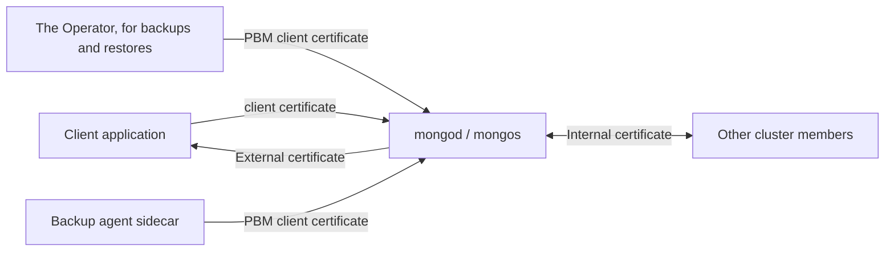

# Transport Layer Security (TLS)

Percona Operator for MongoDB uses the Transport Layer Security (TLS) protocol to encrypt connections to and inside the cluster. Every party in a TLS connection presents its own certificate, so the cluster uses a separate certificate for each role:

| Certificate | Default Secret name | Custom Resource option | Who presents it | What it's for |
| --- | --- | --- | --- | --- |
| External | `<cluster-name>-ssl` | `secrets.ssl` | `mongod` and `mongos` | Connections from client applications |
| Internal | `<cluster-name>-ssl-internal` | `secrets.sslInternal` | Cluster members | Connections between Percona Server for MongoDB instances. The internal certificate also authorizes members of the cluster. |
| PBM client | `<cluster-name>-pbm` | `secrets.sslPBM` | The backup agents, and the Operator when it connects for backups and restores | Connections that Percona Backup for MongoDB (PBM) makes to the database. Available starting with version 1.24.0, when backups are enabled. |

The following diagram shows which certificate each connection uses:



The same certificate authority (CA) signs all three certificates. `mongod` and `mongos` check the certificates that clients present against the CA in the `ca.crt` key of the internal Secret. If there's no separate internal Secret, they use the `ca.crt` key of the external Secret. Clients check the server certificate against the `ca.crt` key of the external Secret.

The PBM client certificate is a client-only certificate. It has no hostnames and carries its own subject, with the organization set to `PBM`.

You control TLS usage with the `tls.mode` option in the Custom Resource. This setting defines how Percona Server for MongoDB cluster handles TLS for both internal and external connections. You can choose from the following modes:

- `allowTLS`: The cluster accepts both TLS and non-TLS incoming connections, but does not use TLS for internal communication.
- `preferTLS` (default): The cluster uses TLS for internal communication and accepts both TLS and non-TLS external connections.
- `requireTLS`: The cluster enforces TLS encryption for all connections and accepts only TLS connections.
- `disabled`: The cluster completely [disables TLS](tls-disable.md) for all connections.

Example configuration:

```yaml
...
spec:
  ...
  tls:
    mode: preferTLS
```

## TLS Certificates

You can configure TLS security in several ways:

| Approach | Best for | Renewal |
| -------- | -------- | ------- |
| Operator-generated certificates (default) | Quick start, development | Manual |
| cert-manager with Operator-managed issuers | Automated TLS without external PKI | Automatic (cert-manager) |
| cert-manager with your existing `Issuer` or `ClusterIssuer` | Production clusters that use the organization's PKI (Smallstep, ACME, etc.) | Automatic (cert-manager) |
| Manual Secrets | Full control, air-gapped or custom PKI workflows | Manual |

* By default, the Operator generates long-term certificates automatically during the cluster creation if there are no
certificate secrets available and no cert-manager is installed. When generating certificates, the Operator creates the Secrets `<cluster-name>-ssl` and `<cluster-name>-ssl-internal`. When backups are enabled, it also creates `<cluster-name>-pbm`. These Secrets are referenced in the `secrets.ssl`, `secrets.sslInternal` and `secrets.sslPBM` options in the Custom Resource.

    Operator-generated certificates are not renewed automatically. You must renew them manually if you need new certificates.

    Leave [`tls.allowInvalidCertificates`](operator.md#tlsallowinvalidcertificates) at `true` (the default) so the MongoDB shell, the Operator, and the backup agent accept these self-signed certificates.

* The Operator can use an installed *cert-manager* to automatically generate and
    renew short-term TLS certificates. By default it creates namespace-scoped issuers
    in the database namespace. Starting with Operator 1.23.0, you can also point it
    at an existing cluster-wide [`ClusterIssuer`](tls-cert-manager.md#use-an-existing-clusterissuer)
    so MongoDB certificates are signed by your organization's CA.
* You can [generate TLS certificates manually](tls-manual.md) and pass them to the Operator as Kubernetes Secrets.

**For testing purposes**, you can use pre-generated certificates available in the
`deploy/ssl-secrets.yaml` file. But we strongly recommend
**to not use them on any production system**!

### Turn on server certificate checks

!!! note "Version added: [1.24.0](RN/Kubernetes-Operator-for-PSMONGODB-RN1.24.0.md)"

Starting with version 1.24.0, setting [`tls.allowInvalidCertificates`](operator.md#tlsallowinvalidcertificates) to `false` makes the Operator and the backup agent check the MongoDB server certificate. The MongoDB shell checks it too.

Set the option to `false` when the Operator and the backup agent trust the CA that signed the certificate, such as your organization's CA. The certificate also has to list every hostname they use to connect. See [`tls.allowInvalidCertificates`](operator.md#tlsallowinvalidcertificates) for those hostnames.

If the check fails, the Operator stops reconciling the cluster and backups fail. The log reports `tls: failed to verify certificate`.

### Certificate management policy

Starting with Operator version 1.23.0, you can control what happens when TLS Secrets are missing via the `spec.tls.certManagementPolicy` option in the Custom Resource:

* `auto` (default) — If Secrets are not found, the Operator creates new certificates automatically (self-signed or via cert-manager). New certificates can replace a lost user-managed Secret with a **new CA**, which triggers a rolling restart of all database Pods, and can disconnect clients that trust the original CA.
* `userProvidedOnly` — The Operator skips auto-creation or replacement of unavailable TLS certificates, so that you control the certificate lifecycle management (manually, via External Secrets, GitOps, or your own cert-manager workflow). If a Secret is missing, Pods keep running with existing certificates where possible, and the Operator sets the `TLSSecretsReady=False` condition until you restore the Secret.

| Your setup | Recommended policy |
|------------|-------------------|
| Operator self-signed or Operator-driven cert-manager | `auto` |
| Manual, External Secrets, or GitOps-managed TLS Secrets in production | `userProvidedOnly` |

Example:

```yaml
spec:
  tls:
    mode: preferTLS
    certManagementPolicy: userProvidedOnly
  secrets:
    ssl: my-cluster-name-ssl
    sslInternal: my-cluster-name-ssl-internal
```

See [Configure the TLS certificate management policy](tls-cert-management-policy.md) for setup steps, monitoring, recovery, and policy switching.

### Connect with a client certificate

`mongod` and `mongos` require a client certificate on every TLS connection. They check that the cluster CA signed it only when [`tls.allowInvalidCertificates`](operator.md#tlsallowinvalidcertificates) is `false`. Give each client application its own client certificate. Don't reuse the external server certificate: MongoDB logs a warning for every connection that presents the server's own certificate.

To issue a client certificate with the CA that the Operator created, use one of the following ways:

=== "cert-manager"

    Create a `Certificate` that the Operator's issuer signs. Save the following manifest as `my-app-client.yaml`. Replace `my-cluster-name` with your cluster name and `my-app` with a name for your application:

    ```yaml
    apiVersion: cert-manager.io/v1
    kind: Certificate
    metadata:
      name: my-app-client
    spec:
      secretName: my-app-client
      commonName: my-app
      subject:
        organizations:
          - my-app
      usages:
        - digital signature
        - key encipherment
        - client auth
      issuerRef:
        name: my-cluster-name-psmdb-issuer
        kind: Issuer
    ```

    `my-cluster-name-psmdb-issuer` of kind `Issuer` is the default issuer that the Operator creates. If you use [another issuer](tls-cert-manager.md#use-an-existing-clusterissuer), set its name and kind.

    ```bash
    kubectl apply -f my-app-client.yaml -n <namespace>
    kubectl get secret my-app-client -n <namespace> -o jsonpath='{.data.tls\.crt}' | base64 -d > tls.crt
    kubectl get secret my-app-client -n <namespace> -o jsonpath='{.data.tls\.key}' | base64 -d > tls.key
    kubectl get secret my-app-client -n <namespace> -o jsonpath='{.data.ca\.crt}' | base64 -d > ca.crt
    ```

=== "Operator-generated certificates"

    Sign a client certificate with the CA from the `<cluster-name>-ca-cert` Secret:

    ```bash
    kubectl get secret my-cluster-name-ca-cert -n <namespace> -o jsonpath='{.data.ca\.crt}' | base64 -d > ca.crt
    kubectl get secret my-cluster-name-ca-cert -n <namespace> -o jsonpath='{.data.ca\.key}' | base64 -d > ca.key
    openssl req -new -newkey rsa:2048 -nodes -keyout tls.key -subj "/O=my-app/CN=my-app" -out client.csr
    openssl x509 -req -in client.csr -CA ca.crt -CAkey ca.key -CAcreateserial -days 365 \
      -extfile <(printf "extendedKeyUsage=clientAuth") -out tls.crt
    ```

    Keep `ca.key` safe, and delete it from your workstation when you're done.

Combine the certificate and the key into one file, then pass it and `ca.crt` to your client. For `mongosh`:

```bash
cat tls.crt tls.key > client.pem
mongosh "<connection-string>" --tls --tlsCertificateKeyFile client.pem --tlsCAFile ca.crt
```

Run this wherever your client actually runs - on your own machine if you
[exposed the cluster](expose.md), or inside a Pod if you're connecting from within
Kubernetes. For a guided walkthrough that does this inside a throwaway Pod, see
[Connection secrets](connection-secrets.md#open-an-interactive-shell-with-mongosh).

If you use your own CA, sign the client certificate with a CA that the `ca.crt` key of the `<cluster-name>-ssl-internal` Secret contains. If you don't use a separate internal Secret, use the CA from `<cluster-name>-ssl`.

## TLS configuration

The following sections provide guidelines how to:

* [Configure TLS security with the Operator using cert-manager](tls-cert-manager.md)
* [Generate certificates manually](tls-manual.md)
* [Update certificates](tls-update.md)
* [Configure the TLS certificate management policy](tls-cert-management-policy.md)
* [Disable TLS temporarily](tls-disable.md)

To use TLS for external traffic, you need to additionally configure your client application. See [this blog post :octicons-link-external-16:](https://www.percona.com/blog/authenticating-your-clients-to-mongodb-on-kubernetes-using-x509-certificates/) for detailed instruction with examples. Also, you can check the [official MongoDB documentation :octicons-link-external-16:](https://www.mongodb.com/docs/manual/tutorial/configure-ssl-clients/). 

For clients outside of your Kubernetes-based environment, you must also [expose your cluster](expose.md).
