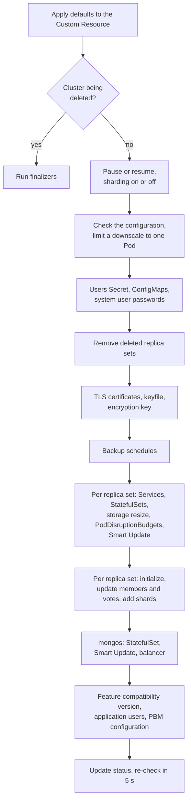
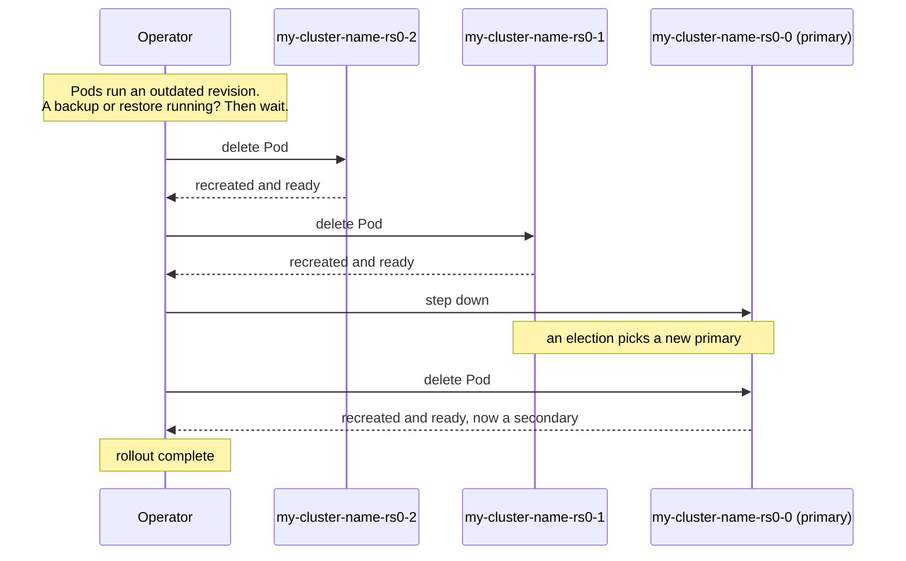

# How the Operator reacts to changes

This page explains what the Operator does after you change the [Custom Resource](glossary.md#custom-resource): when it acts, in which order, which changes restart Pods, and what the cluster status tells you while the change is applied.

## What a reconcile is

The `PerconaServerMongoDB` Custom Resource describes the *desired state* of the cluster. A *reconcile* is one pass of the Operator over the cluster: it reads the Custom Resource, compares it with the *actual state* of the Kubernetes objects and the database, and changes whatever differs. Reconciles repeat continuously, so the cluster converges to the Custom Resource even if a single pass cannot finish the job.

## What triggers a reconcile

* **A change to the Custom Resource.**
* **A periodic re-check.** After each successful pass, the Operator reconciles the cluster again 5 seconds later. Set a longer interval with the [`RECONCILE_INTERVAL`](env-vars-operator.md#reconcile_interval) environment variable of the Operator Deployment. Because of the periodic re-check, manual edits to the objects the Operator manages, such as a [StatefulSet](glossary.md#statefulset) or a Service, are reverted within seconds. A change to the users Secret is also picked up by the next periodic pass, because the Operator doesn't watch Secrets.
* **A retry after an error.** If a pass fails, the Operator retries it with an increasing delay.

!!! note "Why the Operator seems to do nothing after an error"

    After a failed pass, the Operator doesn't re-check the cluster every 5 seconds. It retries with an exponential backoff: the delay starts at a few milliseconds and doubles with each consecutive failure, up to about 16 minutes. The delay resets only after a successful pass. So if a reconcile has been failing for a while and you then fix the cause, for example create a missing Secret, the Operator may not notice it for several minutes.

    Passes in which the Operator only waits, for example for Pods to start or for a backup to finish, are not errors: the Operator still checks again on its regular interval, 5 seconds by default.

    Any change to the Custom Resource starts a new pass immediately. To trigger one without changing the configuration, add or update an annotation:

    ```bash
    kubectl annotate psmdb my-cluster-name percona.com/reconcile-trigger="$(date +%s)" --overwrite
    ```

    The annotation name is arbitrary, and the Operator doesn't read it. Restarting the Operator Pod also resets the backoff.

Only one Operator Pod is active at a time. If you run several replicas, they elect a leader. The Operator watches the namespaces listed in the `WATCH_NAMESPACE` environment variable, or all namespaces if it is empty. See [Install the Operator in multi-namespace mode](cluster-wide.md).

The `MAX_CONCURRENT_RECONCILES` environment variable sets how many objects of each kind the Operator reconciles in parallel. It applies separately to clusters, backups, restores and ClusterSync objects. The default is `1`: the Operator reconciles one cluster at a time, and other clusters wait in the queue. A pass can take long, because a [Smart Update](#how-smart-update-works) waits inside the pass for each restarted Pod. If you run many clusters with one Operator, raise this value. See [Configure concurrency for a cluster reconciliation](reconciliation-concurrency.md).

Backups and restores have reconcile loops of their own. The Operator rechecks a backup or a restore only while it's in progress, every 5 seconds by default. Starting with version 1.24.0, you can make these intervals longer with the `BACKUP_RECONCILE_INTERVAL` and `RESTORE_RECONCILE_INTERVAL` environment variables. A longer interval means fewer Kubernetes API requests, but the backup or restore status updates later, and restores take longer. See [Configure the reconciliation interval](reconciliation-concurrency.md#configure-the-reconciliation-interval).

## Order of operations

Each reconcile runs the same steps in the same order. Knowing the order helps you understand why one change waits for another: for example, a storage resize in progress holds back the Smart Update of that replica set.



## What happens when I change a field

| Field | What the Operator does | Restart? |
| --- | --- | --- |
| `replsets[].size`, `sharding.configsvrReplSet.size`, `sharding.mongos.size` | Changes the number of Pods. On scale-up, it adds the new members to the replica set configuration. On scale-down, it removes one Pod per pass, and then removes the member from the configuration. With the `percona.com/delete-psmdb-pvc` finalizer set, it also deletes the PVCs of the removed Pods. The new size must pass the [safety checks](operator-boundaries.md#stay-inside-safe-operating-limits) | No |
| A replica set removed from `replsets` | In a sharded cluster, checks that it holds no user databases, removes the shard through `mongos`, and deletes the StatefulSet. See [Shards and the balancer](architecture-workflows.md#shards-and-the-balancer) | Its Pods stop |
| `sharding.balancer.enabled` | Turns the balancer on or off through `mongos` | No |
| `arbiter`, `nonvoting` or `hidden` sections | Creates or deletes the StatefulSet for these members, and adds or removes them in the replica set configuration | No |
| Image, resources, environment variables, affinity, sidecars, probes | Updates the Pod template | Yes, a rolling restart in the [Smart Update](#how-smart-update-works) order. Starting with version 1.24.0, a resources change can be applied in place, without a restart, when [`vpa.inPlaceResize`](operator.md) is on |
| A `configuration` section | Updates the ConfigMap. The `percona.com/configuration-hash` annotation on the Pods changes | Yes |
| The contents of the TLS Secrets | The `percona.com/ssl-hash` and `percona.com/ssl-internal-hash` annotations on the Pods change | Yes |
| A system user password in the users Secret | Changes the password in the database, then restarts only the containers that use this user: `backup-agent` for the backup user, `pmm-client` for the PMM token. See [System users](system-users.md) | Selected containers only |
| Storage size, larger | Patches the PVCs and recreates the StatefulSet without deleting its Pods. Requires `storageScaling.enableVolumeScaling`. See [Resize storage](scaling-storage-resize.md) | No |
| Storage size, smaller | Starting with version 1.24.0, with `storageScaling.enableVolumeShrink` on, replaces each PVC with a smaller one, one member at a time. Each member gets its data back through an initial sync | Yes, one member at a time |
| `sharding.enabled` | With backups enabled, pauses the cluster, changes the topology, and starts it again. With backups disabled, restarts the members one by one. See [Turning sharding on and off](sharding.md#turning-sharding-on-and-off) | Yes. With backups enabled, a full stop and start |
| `pause: true` | Waits for running backups, then stops all Pods in a safe order. Data is kept. See [What happens during a pause](pause.md#what-happens-during-a-pause) | Pods stop |
| `upgradeOptions.apply` | On the `upgradeOptions.schedule`, checks for new versions and writes new images into the Custom Resource, which triggers a Smart Update | Yes, when a new version is applied |

## Update strategies

When a change requires restarting Pods, the `updateStrategy` option decides how it happens. There are the following update strategies available: `SmartUpdate` (the default), `RollingUpdate` or `OnDelete`. For what each strategy does, see [Update strategies](update.md#update-strategies). This section explains how Smart Update works in detail.

### How Smart Update works



1. The Operator starts only when every Pod of the StatefulSet is ready. It waits while a backup is running or a PBM operation such as a restore is in progress. A backup in the `waiting` state doesn't hold the rollout back.
2. In a sharded cluster, it updates the config server replica set first and stops the balancer for that time. The shards follow. `mongos` is updated last, from the lowest Pod number up, once every replica set runs the new revision. When a certificate change requires it, the Operator updates `mongos` first instead.
3. It finds the primary and restarts the other Pods first, from the highest number down.
4. After each restart, it waits until the Pod runs the new revision and its `mongod` container is ready. The [readiness probe](architecture-probes.md#what-the-probes-check) passes only when the member is `PRIMARY`, `SECONDARY` or `ARBITER`.
5. It asks the primary to step down, waits for the election, and restarts the former primary last. Hidden and non-voting members are never primary, so their StatefulSets update without a step-down.

The Operator waits for each Pod for as many seconds as the liveness probe's `initialDelaySeconds`, 90 by default. If a Pod isn't ready by then, the pass fails with the `reach pod wait limit` error, and the next pass continues the rollout from where it stopped. While it waits, the Operator logs show what it is waiting for.

The balancer is turned back on when every StatefulSet runs the current revision and no backup or restore is running.

### Automatic upgrades

With `upgradeOptions.apply` set to `Recommended`, `Latest` or a specific version, the Operator checks the Percona Version Service on the `upgradeOptions.schedule` and, if a new version is available, writes the new images into the Custom Resource. The Smart Update then rolls them out. The check runs only when the cluster is `ready`. The default value `disabled` turns automatic upgrades off. See [Automatic minor upgrade](update-minor-automatic.md).

Upgrade the Operator itself and its CRDs before you raise `spec.crVersion`. See [Upgrade the Operator and CRD](update-operator.md).

## Status

The `status.state` field of the Custom Resource shows where the cluster is: `initializing`, `ready`, `paused`, `stopping` or `error`. The Operator sets it at the end of every pass. When a pass fails, the state is `error`, and the reason is in `status.message` and in a condition with the reason `ErrorReconcile`.

* For the conditions the cluster must meet to be `ready`, see [What `ready` means](cr-statuses.md#what-ready-means).
* If the cluster stays in `initializing`, see [Cluster stays in `initializing`](troubleshoot-operator.md#cluster-stays-in-initializing).
* For all status fields and conditions, see [Custom resource statuses](cr-statuses.md#perconaservermongodb-status).

The status doesn't show everything. If the state looks wrong but there is no message, read the Operator logs. See [Which layer is it?](debug.md#which-layer-is-it).

## Next steps

[Key workflows](architecture-workflows.md){.md-button}

## See also

* [Custom Resource options](operator.md)
* [Custom resource statuses](cr-statuses.md)
* [Initial troubleshooting](debug.md)
