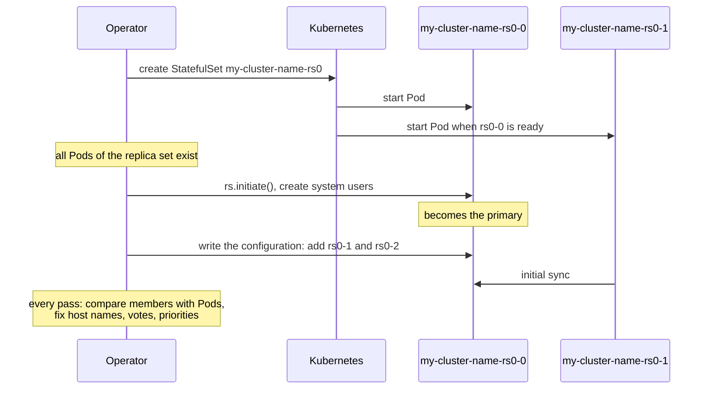
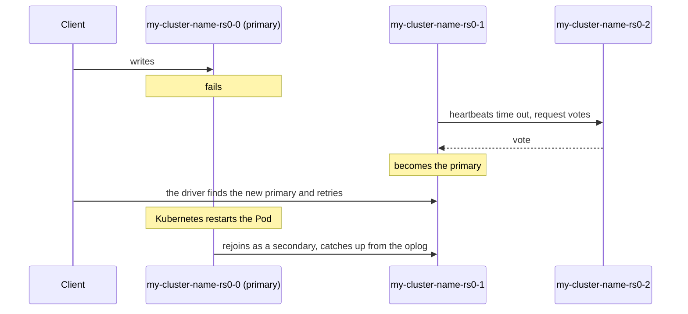
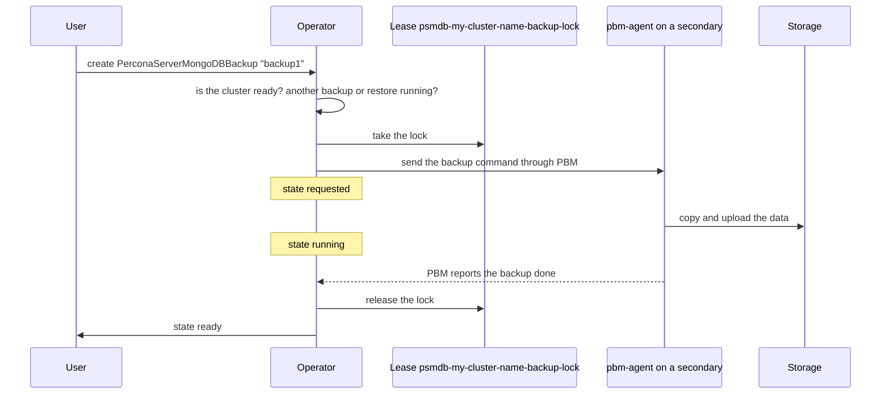
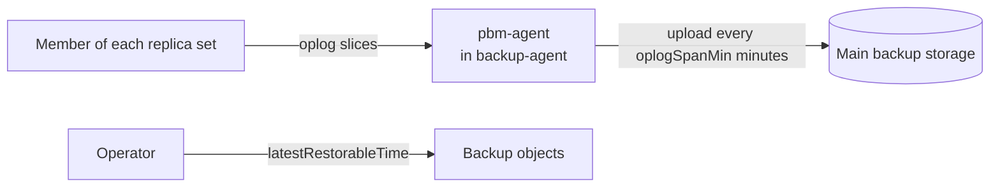
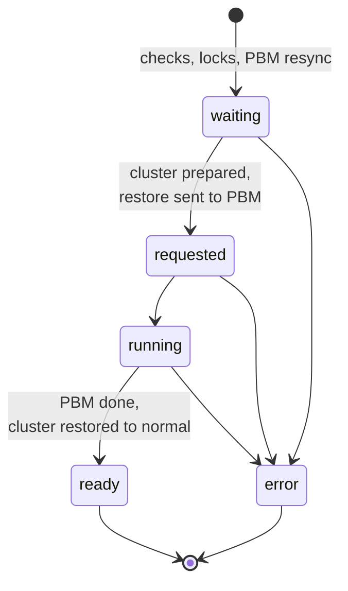

# Key workflows

This page describes the main workflows of the Operator step by step: how it builds and maintains the replica sets, what happens when a primary fails, and how backups, point-in-time recovery and restores work. Each section ends with the objects and fields to check when the workflow fails.

The examples use a cluster named `my-cluster-name`.

## Replica set membership

The Operator turns the Pods of a StatefulSet into a replica set and keeps the replica set configuration matching the Pods.

**What happens:**

1. **Initialization.** The Operator waits until every Pod of the replica set exists. A Pod in `CrashLoopBackOff` puts the cluster in the `error` state. Then it runs `rs.initiate()` on one member and creates the [system users](system-users.md). In a sharded cluster, it initializes the config server replica set and each shard the same way.
2. **Shards.** In a sharded cluster, once `mongos` runs, the Operator adds each replica set as a shard through `mongos`. It also sets the default read and write concern from the `defaultRWConcern` section, if you set it.
3. **Members.** On every pass, the Operator builds the list of members it wants from the Pods and from the `externalNodes` you listed, and compares it with the replica set configuration. When they differ, it writes a new configuration. It fixes member host names, stepping the primary down first if its own host name changes. It updates member settings, removes members whose Pods are gone, and adds members for new Pods. A new member starts with an empty volume and copies the data with an [initial sync](glossary.md#initial-sync).
4. **Votes.** At most 7 members vote. If the number of voting members would be even, the Operator takes a vote away, starting with hidden members, so that elections always have a clear majority. It changes the vote of only one member per configuration change and never takes the vote from the primary, so that the replica set keeps its fault tolerance while votes move.
5. **Priorities.** Members get the default priority. Members you match with `primaryPreferTagSelector` get a higher priority, and you can set a priority for one Pod with `replsetOverrides`. Arbiter, non-voting and hidden members have priority 0 and never become primary.

With `unmanaged: true`, the Operator skips all of this. It creates the Pods, but you or a managed cluster on another site own the replica set configuration. See [Multi-cluster deployments](operator-boundaries.md#multi-cluster-deployments).

**Where to look if it fails:**

* `kubectl get psmdb my-cluster-name -o yaml`: `status.replsets.<name>.initialized`, the `ready` and `size` counts, and the member list.
* Operator logs: `Adding new nodes`, `Removing old nodes`, `Fixing hostname of member` and `Configuring member votes and priorities` show each change to the configuration.
* `rs.status()` and `rs.conf()` in `mongosh` as the `clusterAdmin` user show what MongoDB sees. See [Exec into the containers](debug-shell.md).
* More symptoms and the layer that owns each: [Initial troubleshooting](debug.md#where-to-look-first).

## Shards and the balancer

This section applies to sharded clusters only.

**Adding a shard.** When you add a replica set to `replsets`, the Operator creates its StatefulSet and initializes the replica set. Then it adds the replica set as a shard through `mongos`, and the balancer starts moving chunks to it.

**Removing a shard.** When you remove a replica set from `replsets`, the Operator does the following:

1. It connects to the replica set and lists its databases. If the replica set holds any database other than the system databases, the Operator stops. The cluster goes to the `error` state with the message `non system db found: <database>`. Move or drop those databases first.
2. It runs `removeShard` through `mongos`, and repeats it every 10 seconds until MongoDB reports that the shard is drained and removed. The pass waits for this to finish.
3. It deletes the StatefulSet. The PVCs of the removed replica set stay. Delete them yourself when you no longer need the data.

**`mongos`.** The Operator creates and updates the `mongos` StatefulSet only when every other StatefulSet of the cluster runs its current revision, and never while a restore runs. So a pending rollout of a replica set also holds back a `mongos` change.

**The balancer.** The Operator keeps the balancer in the state `sharding.balancer.enabled` asks for, `true` by default. It stops the balancer while it restarts the config server replica set. It turns the balancer back on only when every StatefulSet runs its current revision, no backup or restore is running, no storage shrink is in progress, and the cluster isn't paused. A balancer you stop or start with `sh.stopBalancer()` or `sh.startBalancer()` is set back on the next pass, so use the CR option.

**Where to look if it fails:**

* `kubectl get psmdb my-cluster-name -o yaml`: `status.message` for the `non system db found` error.
* Operator logs: the `removeShard` progress messages, and the balancer changes.
* `sh.status()` in `mongosh` through `mongos`: the shards, the balancer state and the chunk distribution.
* More symptoms and the layer that owns each: [Initial troubleshooting](debug.md#where-to-look-first).

## Primary failover

When the primary fails or is unavailable, MongoDB elects a new one. The Operator isn't involved.

**What happens:**

* The secondaries notice the missing heartbeats and hold an election. A secondary that gets the votes of a majority of the voting members becomes the primary.
* Drivers find the new primary from the replica set and send new writes there. Writes in flight during the election fail, and drivers retry them once by default.
* In a sharded cluster, `mongos` finds the new primary of the shard the same way. Clients stay connected to `mongos`.
* The config server replica set fails over the same way. Until it has a primary, the cluster metadata can't change: no chunk migrations, no new databases or collections. Reads and writes to the shards continue. See [Config server availability :octicons-link-external-16:](https://www.mongodb.com/docs/manual/core/sharded-cluster-config-servers/#config-server-availability).
* When the failed member comes back with the same host name and its data, it rejoins as a secondary and catches up from the primary's oplog. If it was down for longer than the oplog covers, it stays `RECOVERING` and needs a full copy of the data.
* Writes that the old primary accepted but didn't replicate to a majority are rolled back when it rejoins. Use the `majority` write concern for data you can't lose.

**Where to look if it fails:**

* `kubectl get pods`: a member that stays not ready, and its restart count.
* `kubectl logs my-cluster-name-rs0-0 -c mongod`: election and rollback messages.
* [Troubleshoot connection issues](troubleshoot-connection.md) for drivers that don't find the new primary.
* More symptoms and the layer that owns each: [Initial troubleshooting](debug.md#where-to-look-first).

## Replica set without a primary

An election needs a majority of the voting members. If more members are lost than the replica set can tolerate, for example two of three, the remaining members stay secondaries and the replica set accepts no writes.

**What happens:**

1. The Operator can't connect to a primary. Starting with version 1.24.0, it retries for about 80 seconds first, so that a normal election doesn't trigger the next step.
2. It logs `FULL CLUSTER CRASH` and connects to the first ready `mongod` Pod of the replica set directly, as the `clusterAdmin` user.
3. It reads the replica set configuration from that member and writes it back as a *forced reconfiguration*. Starting with version 1.24.0, it first removes the members that have no Pod and are not listed in `externalNodes`, so that missing members no longer count toward the majority.
4. With enough voting members left, the remaining members elect a primary.

If no `mongod` Pod is ready, the Operator waits. Members whose Pods still exist stay in the configuration, even if they are down. In that case, the replica set elects a primary only when enough of them come back.

!!! warning "A forced reconfiguration can lose writes"

    A forced reconfiguration lets the remaining members elect a primary without the members that are gone. Writes that only the lost members had are not on the new primary. If the lost members come back, MongoDB rolls those writes back. Check the [rollback files :octicons-link-external-16:](https://www.mongodb.com/docs/manual/core/replica-set-rollbacks/) after such an event.

**Where to look if it fails:**

* Operator logs: `FULL CLUSTER CRASH` and the errors that follow.
* `kubectl get pods`: whether any `mongod` Pod of the replica set is ready.
* `rs.status()` on a remaining member: its state and the members it sees.
* More symptoms and the layer that owns each: [Initial troubleshooting](debug.md#where-to-look-first).

## On-demand backup

The PBM agents in the `backup-agent` containers make the backups. The Operator decides when a backup may start and tells PBM to run it.

**What happens:**

1. You create a `PerconaServerMongoDBBackup` object. See [Make on-demand backups](backups-ondemand.md).
2. The Operator waits until the cluster is `ready`. To back up a cluster that isn't `ready`, set `unsafeFlags.backupIfUnhealthy`. Even then, every replica set needs at least one ready member.
3. If another backup or a restore is running, or a ClusterSync replicates into the cluster, the backup goes to the `waiting` state.
4. The Operator takes the `psmdb-my-cluster-name-backup-lock` [Lease](glossary.md#lease), so that only one backup runs at a time. Backups that don't get the lock stay `waiting`.
5. It sends the backup command to PBM. A PBM agent on one member of each replica set copies the data and uploads it to the storage. PBM chooses the member by priority: by default, hidden members first, then secondaries, and the primary last. Before version 1.24.0, the Operator also wrote PBM priorities that kept backups off the primary and off external members. Starting with version 1.24.0, it leaves the choice to PBM. See [How backup and restore work](backups.md#how-backup-and-restore-work) for what each backup type copies.
6. The Operator follows the progress in PBM, sets the state to `ready` or `error`, and releases the lock.

The backup goes through these states: empty while the Operator hasn't processed it, `waiting`, `requested`, `running`, and `ready` or `error`. See [Backup state values](cr-statuses.md#backup-state-values).

`startingDeadlineSeconds` limits how long a new backup may wait before it starts. If it is omitted from the backup resource, the Operator uses `backup.startingDeadlineSeconds` from the cluster Custom Resource, or defaults to 120 seconds. When the deadline is exceeded, the backup fails.

When you delete a backup object, the `percona.com/delete-backup` [finalizer](glossary.md#finalizer) removes the backup files from the storage first.

**Where to look if it fails:**

* `kubectl get psmdb-backup backup1 -o yaml`: the state, `status.error`, and `status.pbmPods`, which names the member that made the backup.
* `kubectl logs <pod> -c backup-agent` on that member: errors from PBM, such as wrong storage credentials or an unreachable endpoint.
* Operator logs: `Cluster is not ready for backup`, `Waiting to finish another backup/restore` and `Another backup is holding the lock` show why a backup waits.
* See [Troubleshoot backups and restores](debug-backup-restore.md).
* More symptoms and the layer that owns each: [Initial troubleshooting](debug.md#where-to-look-first).

## Scheduled backups

Scheduled backups are not Kubernetes CronJobs. The Operator keeps the schedules from `backup.tasks` in its own memory and, when a run is due, creates a regular backup object named `cron-<cluster-name>-<timestamp>-<suffix>`, with the cluster name cut to 16 characters. The `percona.com/backup-ancestor` label holds the task name. From there, the backup follows the [on-demand workflow](#on-demand-backup).

* **The Operator creates the backup object even if the cluster isn't `ready`.** The backup then waits until the cluster is `ready`, or until its `startingDeadlineSeconds` runs out.
* **The schedule runs only while the Operator runs.** Starting with version 1.24.0, when the Operator starts and finds that a task missed a run, it creates one catch-up backup right away. See [Making scheduled backups](backups-scheduled.md).
* **Retention.** With `retention` set, the Operator deletes the oldest backups of the task beyond the configured count. Retention doesn't apply to incremental backups. See [Delete the unneeded backup](backups-delete.md).

**Where to look if it fails:**

* `kubectl get psmdb-backup -l percona.com/backup-ancestor=<task-name>`: the backups of one task and their states.
* Operator logs: errors creating backups and the backups deleted for retention.
* More symptoms and the layer that owns each: [Initial troubleshooting](debug.md#where-to-look-first).

## Point-in-time recovery

**What happens:**

* When you set `backup.pitr.enabled` to `true`, the Operator turns on oplog slicing in the PBM configuration. No extra Pods are created.
* A PBM agent in each replica set uploads the oplog to the main backup storage in slices, every `backup.pitr.oplogSpanMin` minutes.
* PBM uploads the oplog only after a full backup exists. Take a full backup for a new cluster and after every restore.
* The `status.latestRestorableTime` field of a backup shows the latest point you can restore to.
* The Operator turns oplog slicing off right before a restore. PVC snapshot backups don't support point-in-time recovery.

See [Enable point-in-time recovery](backups-pitr.md).

**Where to look if it fails:**

* `kubectl get psmdb-backup <backup> -o yaml`: `latestRestorableTime`.
* `kubectl logs <pod> -c backup-agent`: oplog upload errors, such as storage access problems.
* More symptoms and the layer that owns each: [Initial troubleshooting](debug.md#where-to-look-first).

## Restore

A restore replaces the data of the whole cluster, or of selected namespaces for a selective restore. You start it by creating a `PerconaServerMongoDBRestore` object. See [Restore from a backup](backups-restore.md).

**What happens:**

1. **Checks.** The Operator checks the backup: with `backupName`, the backup object must be `ready`. It also checks that no backup, restore or ClusterSync holds the cluster, and that the PBM agents are up. If PBM doesn't know the backup, the Operator asks PBM to resync the storage first. The restore stays `waiting` meanwhile.
2. **Preparation.** What the Operator does depends on the topology and the restore type. In a sharded cluster, it stops `mongos` for every restore type, so clients can't connect. For a physical, incremental or PVC snapshot restore, it also stops the arbiters, runs PBM inside the `mongod` containers and restarts the members. A logical restore of a replica set leaves the members running, and clients stay connected, so stop your applications first. Oplog slicing for point-in-time recovery is turned off. For the downtime of each restore type, see [Downtime to expect](backups-restore.md#downtime-to-expect).
3. **Restore.** PBM restores the data, and for point-in-time recovery, replays the oplog up to the target.
4. **Return to normal.** The Operator brings back `mongos`, the arbiters and the regular StatefulSet configuration, and sets the state to `ready`. A restore that fails sets the state to `error`, with the reason in `status.error`.

The step-by-step flows for each backup type are in [How backup and restore work](backups.md#how-backup-and-restore-work).

!!! warning "A restore overwrites data"

    The data written after the backup or the point-in-time target is lost. A sharded cluster is unavailable to clients while `mongos` is stopped, and a physical restore restarts every member. After a failed restore, the Operator can't guarantee data consistency. Take a new full backup after every restore.

**Where to look if it fails:**

* `kubectl get psmdb-restore <restore> -o yaml`: the `state`, the waiting reason, and the error in `status.error`.
* `kubectl logs <pod> -c backup-agent` for a logical restore, or the `mongod` container logs for a physical restore. See [View restore logs](debug-backup-restore.md#view-restore-logs).
* Operator logs.
* More symptoms and the layer that owns each: [Initial troubleshooting](debug.md#where-to-look-first).

## Next steps

[Health checks and probes](architecture-probes.md){.md-button}

## See also

* [About high availability and topology](ha-topology.md)
* [Backup and restore](backups.md)
* [Troubleshoot backups and restores](debug-backup-restore.md)
