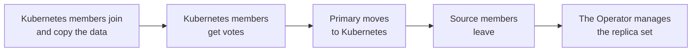

# Migrate with cross-site replication

This guide moves a self-hosted MongoDB replica set into the Operator with cross-site replication. Use this method when you control the source deployment: MongoDB Community, MongoDB Enterprise Advanced, Percona Server for MongoDB, or a cluster that the Operator runs in another Kubernetes cluster. It doesn't work for MongoDB Atlas, which doesn't accept external replica set members. To compare methods, see [Migrate to the Operator](migration.md). To keep both sites running for disaster recovery instead, see [Plan your multi-cluster or multi-region deployment](replication-plan-deployment.md).

This page covers a replica set. For a sharded cluster, see [Sharded clusters](#sharded-clusters).

## How it works

Members running in Kubernetes join your source replica set, copy the data and take over as primary. Then the source members leave, and the Operator takes over the replica set. Until this handover, the Kubernetes cluster runs in unmanaged mode: the Operator starts the Pods but doesn't configure the replica set. To learn more about unmanaged mode, see [Cross-site replication](replication.md#cross-site-replication).



* **Network:** the source and Kubernetes members connect to each other in both directions until the source members leave.
* **Rollback:** until the primary moves, you can abandon the migration and the source runs as before. After the primary moves, you step back first. See [Abandon the migration](#abandon-the-migration).
* **Risk window:** from the moment the Kubernetes members get votes until the source members leave, the replica set needs both sites for a majority. If the link between them fails, writes stop on both sides.
* **Downtime:** applications pause only for the election when the primary moves.

## Before you start

* The Operator 1.24.0 or later is installed in the target namespace. See [Install the Operator](kubectl.md). Don't create a cluster yet.
* The source is a replica set with keyfile internal authentication. A standalone `mongod` must be [converted to a replica set :octicons-link-external-16:](https://www.mongodb.com/docs/manual/tutorial/convert-standalone-to-replica-set/) first.
* You know the source replica set name, its MongoDB version and the path to its keyfile.
* You have a DNS name for each Kubernetes member and can create DNS records for them, or you use the external IP addresses of the Pods' Services.
* Every source member and every Kubernetes member can reach each other on the MongoDB port, in both directions.
* You can connect to the source primary as a user with the `clusterAdmin` and `userAdminAnyDatabase` roles.
* If the source uses TLS, ensure you have its CA certificate or can get certificates signed by that CA. If the source requires client certificates, you also need a client certificate for `mongosh`. It does when `mongod` runs with `--tlsCAFile` and without `--tlsAllowConnectionsWithoutCertificates`.
* The Kubernetes members will run the same MongoDB major version as the source. Pick the Percona Server for MongoDB image closest to the source version, and keep the Feature Compatibility Version (FCV) unchanged until the migration is done.
* You've made the checks in [Migrate to the Operator](migration.md#before-you-start).

Export your namespace. Replace `<namespace>` with your value:

```bash
export NAMESPACE=<namespace>
```

This guide uses the following conventions:

* The replica set name `rs0`. The replica set name in Kubernetes must match the source.
* The cluster name `my-cluster-name`.
* The member addresses `rs0-0.k8s.example.com` to `rs0-2.k8s.example.com`. If you use the external IP addresses of the Services, use them wherever the guide shows these names.
* MongoDB and Percona Server for MongoDB 8.0.

Replace the names with yours.

## 1. Create the Operator's system users on the source

The Operator connects to MongoDB with its own system users. Because the Kubernetes members copy the `admin` database from the source, these users must exist on the source before the migration, with the passwords you'll put in the Kubernetes users Secret.

1. Choose a password for each user and keep them for step 2.
2. Connect to the source primary and run the following, with your passwords:

    ```javascript
    use admin

    db.createRole({
      role: "explainRole",
      privileges: [
        { resource: { db: "", collection: "" }, actions: ["listIndexes", "listCollections", "dbStats", "dbHash", "collStats", "find"] },
        { resource: { db: "", collection: "system.profile" }, actions: ["indexStats", "dbStats", "collStats"] },
        { resource: { db: "admin", collection: "system.version" }, actions: ["find"] }
      ],
      roles: []
    })

    db.createRole({
      role: "pbmAnyAction",
      privileges: [ { resource: { anyResource: true }, actions: ["anyAction"] } ],
      roles: []
    })

    db.createUser({ user: "userAdmin", pwd: "<userAdmin-password>", roles: ["userAdminAnyDatabase"] })
    db.createUser({ user: "clusterAdmin", pwd: "<clusterAdmin-password>", roles: ["clusterAdmin", "directShardOperations"] })
    db.createUser({ user: "clusterMonitor", pwd: "<clusterMonitor-password>", roles: ["clusterMonitor", "explainRole", { role: "read", db: "local" }, "directShardOperations"] })
    db.createUser({ user: "backup", pwd: "<backup-password>", roles: ["backup", "readWrite", "clusterMonitor", "restore", "pbmAnyAction"] })
    db.createUser({ user: "databaseAdmin", pwd: "<databaseAdmin-password>", roles: ["readWriteAnyDatabase", "readAnyDatabase", "restore", "backup", "dbAdminAnyDatabase", "clusterMonitor"] })
    ```

    On MongoDB 6.0 and 7.0, leave out the `directShardOperations` role. It exists from MongoDB 8.0.

## 2. Create the Secrets in Kubernetes

1. Create the users Secret with the same user names and passwords:

    ```yaml title="my-cluster-name-secrets.yaml"
    apiVersion: v1
    kind: Secret
    metadata:
      name: my-cluster-name-secrets
    type: Opaque
    stringData:
      MONGODB_BACKUP_USER: backup
      MONGODB_BACKUP_PASSWORD: <backup-password>
      MONGODB_DATABASE_ADMIN_USER: databaseAdmin
      MONGODB_DATABASE_ADMIN_PASSWORD: <databaseAdmin-password>
      MONGODB_CLUSTER_ADMIN_USER: clusterAdmin
      MONGODB_CLUSTER_ADMIN_PASSWORD: <clusterAdmin-password>
      MONGODB_CLUSTER_MONITOR_USER: clusterMonitor
      MONGODB_CLUSTER_MONITOR_PASSWORD: <clusterMonitor-password>
      MONGODB_USER_ADMIN_USER: userAdmin
      MONGODB_USER_ADMIN_PASSWORD: <userAdmin-password>
    ```

2. Create the keyfile Secret from the source keyfile. The key must be `mongodb-key`:

    ```bash
    kubectl create secret generic my-cluster-name-mongodb-keyfile -n $NAMESPACE --from-file=mongodb-key=<path-to-source-keyfile>
    ```

3. Apply the users Secret:

    ```bash
    kubectl apply -f my-cluster-name-secrets.yaml -n $NAMESPACE
    ```

4. If the source uses TLS, create the TLS Secrets with the certificates signed by the CA the source trusts. See [Generate certificates manually](tls-manual.md) for the Secret format. Create three Secrets:

    * `my-cluster-name-ssl` for client connections and `my-cluster-name-ssl-internal` for connections between members. Both certificates need the `serverAuth` and `clientAuth` key usages, and must include the addresses of the Kubernetes members: their DNS names or IP addresses.
    * `my-cluster-name-pbm`, the client certificate that PBM uses. Sign it with the same CA and give it a subject that differs from the member certificates. The Operator needs it when you [turn on backups](#7-hand-the-replica-set-to-the-operator).

    If you use the external IP addresses of the Services, you will know them only after you [deploy the target on Kubernetes](#3-deploy-the-kubernetes-members-in-unmanaged-mode). Create the member certificates with the Kubernetes Service names now, and add the IP addresses in [step 3.5](#3-deploy-the-kubernetes-members-in-unmanaged-mode).

## 3. Deploy the Kubernetes members in unmanaged mode

1. Edit `deploy/cr.yaml`:

    * `spec.unmanaged: true`, so the Operator doesn't configure the replica set.
    * `spec.updateStrategy: RollingUpdate`. Smart Update isn't available for unmanaged clusters.
    * `spec.image`: the Percona Server for MongoDB image with the same major version as the source.
    * `spec.secrets.users` and `spec.secrets.keyFile`: the Secrets from step 2. Setting `keyFile` makes the members use keyfile internal authentication, like the source.
    * `spec.replsets[].name`: the source replica set name.
    * `spec.replsets[].expose`: a Service per Pod that the source can reach, for example `type: LoadBalancer`.
    * `spec.replsets[].replsetOverrides`: the address of each Pod, a DNS name or the external IP address of its Service. The Operator uses these addresses in the replica set configuration after the handover, so they must be the addresses you add to the source. With DNS names, set them when you first apply the Custom Resource. With IP addresses, add them in [step 5](#3-deploy-the-kubernetes-members-in-unmanaged-mode) after the Services get their addresses.
    * `spec.sharding.enabled: false` and `spec.backup.enabled: false`.
    * TLS settings that match the source. Use the tab that matches your source.

    === "With TLS"

        ```yaml title="cr.yaml"
        apiVersion: psmdb.percona.com/v1
        kind: PerconaServerMongoDB
        metadata:
          name: my-cluster-name
        spec:
          crVersion: {{ release }}
          unmanaged: true
          updateStrategy: RollingUpdate
          image: percona/percona-server-mongodb:<source-major-version>
          secrets:
            users: my-cluster-name-secrets
            keyFile: my-cluster-name-mongodb-keyfile
            ssl: my-cluster-name-ssl
            sslInternal: my-cluster-name-ssl-internal
            sslPBM: my-cluster-name-pbm
          tls:
            mode: preferTLS
          replsets:
          - name: rs0
            size: 3
            expose:
              enabled: true
              type: LoadBalancer
            replsetOverrides:
              my-cluster-name-rs0-0:
                host: rs0-0.k8s.example.com:27017
              my-cluster-name-rs0-1:
                host: rs0-1.k8s.example.com:27017
              my-cluster-name-rs0-2:
                host: rs0-2.k8s.example.com:27017
            volumeSpec:
              persistentVolumeClaim:
                resources:
                  requests:
                    storage: <at-least-the-source-data-size>
          sharding:
            enabled: false
          backup:
            enabled: false
            image: percona/percona-backup-mongodb:{{ pbmrecommended }}
        ```

    === "Without TLS"

        ```yaml title="cr.yaml"
        apiVersion: psmdb.percona.com/v1
        kind: PerconaServerMongoDB
        metadata:
          name: my-cluster-name
        spec:
          crVersion: {{ release }}
          unmanaged: true
          updateStrategy: RollingUpdate
          image: percona/percona-server-mongodb:<source-major-version>
          unsafeFlags:
            tls: true
          tls:
            mode: disabled
          secrets:
            users: my-cluster-name-secrets
            keyFile: my-cluster-name-mongodb-keyfile
          replsets:
          - name: rs0
            size: 3
            expose:
              enabled: true
              type: LoadBalancer
            replsetOverrides:
              my-cluster-name-rs0-0:
                host: rs0-0.k8s.example.com:27017
              my-cluster-name-rs0-1:
                host: rs0-1.k8s.example.com:27017
              my-cluster-name-rs0-2:
                host: rs0-2.k8s.example.com:27017
            volumeSpec:
              persistentVolumeClaim:
                resources:
                  requests:
                    storage: <at-least-the-source-data-size>
          sharding:
            enabled: false
          backup:
            enabled: false
            image: percona/percona-backup-mongodb:{{ pbmrecommended }}
        ```

        To turn on TLS after the migration, see [Transport Layer Security](TLS.md).

2. Apply it:

    ```bash
    kubectl apply -f deploy/cr.yaml -n $NAMESPACE
    ```

3. Wait until the three Pods are `Running`. The cluster stays in the `initializing` state, because the members aren't part of a replica set yet. After the initial sync in step 5, it reports `ready`.

    ```bash
    kubectl get pods -n $NAMESPACE
    ```

4. Get the external address of each Pod's Service:

    ```bash
    kubectl get svc -n $NAMESPACE
    ```

5. Make sure the source can reach each address in `replsetOverrides`:

    * If you use DNS names, create a DNS record for each name that points to the external IP address of the matching Pod's Service. The source members and the Kubernetes Pods must both resolve these names.
    * If you use the external IP addresses of the Services instead, you have nothing to create. The addresses exist only after the Services are created, so set `replsetOverrides` now. If the source uses TLS, first issue the member certificates again with these IP addresses and replace the `my-cluster-name-ssl` and `my-cluster-name-ssl-internal` Secrets. Then patch the Custom Resource. Replace `<ip-rs0-0>` to `<ip-rs0-2>` with the addresses from the previous step:

        ```bash
        kubectl patch psmdb my-cluster-name -n $NAMESPACE --type=json -p '[{"op":"add","path":"/spec/replsets/0/replsetOverrides","value":{
          "my-cluster-name-rs0-0":{"host":"<ip-rs0-0>:27017"},
          "my-cluster-name-rs0-1":{"host":"<ip-rs0-1>:27017"},
          "my-cluster-name-rs0-2":{"host":"<ip-rs0-2>:27017"}}}]'
        ```

        The Pods restart once and pick up the new certificates and addresses.

6. Check the connections in both directions, at the addresses from `replsetOverrides`. The examples use TLS. Without TLS, leave out the `--tls` options.

    1. From a source member, check that each Kubernetes member answers:

        ```bash
        mongosh --host rs0-0.k8s.example.com --port 27017 --tls --tlsCAFile ca.crt --tlsCertificateKeyFile client.pem --eval 'db.adminCommand({ ping: 1 })'
        ```

    2. From a Kubernetes Pod, check that each source member answers:

        ```bash
        kubectl exec my-cluster-name-rs0-0 -c mongod -n $NAMESPACE -- \
          mongosh --host mongo1.example.com --port 27017 --tls --tlsCAFile /etc/mongodb-ssl/ca.crt --tlsCertificateKeyFile /tmp/tls-internal.pem --eval 'db.adminCommand({ ping: 1 })'
        ```

## 4. Add the Kubernetes members to the source replica set

Connect to the source primary as a user with the `clusterAdmin` role. Add each Kubernetes member as a non-voting member with priority `0`, one at a time. A non-voting member can't take part in elections, so the new members can't affect the source while they copy data.

Add the members soon after the Pods report `Running`. Until a member joins the replica set, its liveness check can fail and Kubernetes restarts the Pod. This stops once the member joins.

```javascript
rs.add({ host: "rs0-0.k8s.example.com:27017", priority: 0, votes: 0 })
rs.add({ host: "rs0-1.k8s.example.com:27017", priority: 0, votes: 0 })
rs.add({ host: "rs0-2.k8s.example.com:27017", priority: 0, votes: 0 })
```

`rs.add()` succeeds even if a member can't be reached. 

## 5. Wait for the initial sync

Check the replica set status on the **source primary**:

```javascript
rs.status().members.map(m => ({ name: m.name, state: m.stateStr, optime: m.optimeDate }))
```

The initial sync is done when every Kubernetes member is `SECONDARY` and its `optime` is close to the primary's. Large datasets take hours. Keep an eye on the source oplog window during this time: the copy fails if the oplog rolls over first.

## 6. Move the primary to Kubernetes

A replica set must keep the majority of voting members reachable at every step. MongoDB also allows only one voting member to be added or removed per configuration change, so you change members one at a time. If you want to rollback, see [Abandon the migration](#abandon-the-migration).

1. Make the Kubernetes members voting members, one per configuration change. Run this on the source primary, with the index of each Kubernetes member from `rs.conf().members`:

    ```javascript
    cfg = rs.conf()
    cfg.members[<index>].votes = 1
    cfg.members[<index>].priority = 1
    rs.reconfig(cfg)
    ```

    Repeat for each Kubernetes member. With three source members and three Kubernetes members, the replica set briefly has six voting members, which stays within MongoDB's limit of seven.

    !!! warning

        While the Kubernetes members vote, the replica set needs both sites for a majority. If the link between the sites fails, the source loses its primary and writes stop. Keep the time until sub-step 6 short. To recover, see [The replica set has no primary after the link between the sites fails](#the-replica-set-has-no-primary-after-the-link-between-the-sites-fails).

2. You don't need to stop writes. Drivers that connect with a replica set connection string follow the primary when it moves.

3. Give the Kubernetes members a higher priority than the source members, in one configuration change:

    ```javascript
    k8sMembers = ["rs0-0.k8s.example.com:27017", "rs0-1.k8s.example.com:27017", "rs0-2.k8s.example.com:27017"]
    cfg = rs.conf()
    cfg.members.forEach(m => { if (k8sMembers.includes(m.host)) { m.priority = 2 } })
    rs.reconfig(cfg)
    ```

4. Step down the source primary:

    ```javascript
    rs.stepDown()
    ```

5. Check that a Kubernetes member is now the primary:

    ```javascript
    rs.status().members.filter(m => m.stateStr === "PRIMARY").map(m => m.name)
    ```

6. Remove the source members through the new primary in Kubernetes:

    1. Get the `clusterAdmin` password from the users Secret:

        ```bash
        export CLUSTER_ADMIN_PASSWORD=$(kubectl get secret my-cluster-name-secrets -n $NAMESPACE -o jsonpath='{.data.MONGODB_CLUSTER_ADMIN_PASSWORD}' | base64 --decode)
        ```

    2. Find the primary:

        ```bash
        kubectl exec my-cluster-name-rs0-0 -c mongod -n $NAMESPACE -- \
          mongosh -u clusterAdmin -p "$CLUSTER_ADMIN_PASSWORD" --authenticationDatabase admin --quiet --eval 'db.hello().primary'
        ```

        The output is an address from `replsetOverrides`. The Pod with this address in `replsetOverrides` is the primary.

    3. Connect to the primary Pod and remove the source members, one at a time:

        ```bash
        kubectl exec -it <primary-pod> -c mongod -n $NAMESPACE -- \
          mongosh -u clusterAdmin -p "$CLUSTER_ADMIN_PASSWORD" --authenticationDatabase admin
        ```

        ```javascript
        rs.remove("mongo1.example.com:27017")
        rs.remove("mongo2.example.com:27017")
        rs.remove("mongo3.example.com:27017")
        rs.status().members.map(m => m.name + " " + m.stateStr)
        ```

        The last command must list only the Kubernetes members, with one `PRIMARY`.

7. Point your applications at the Kubernetes members. The connection strings are in [Connection secrets](connection-secrets.md#retrieve-a-connection-string). Update the connection strings before your applications next restart. A client that starts with the old connection string can't connect once the source members are removed.

## 7. Hand the replica set to the Operator

1. Switch the cluster to the managed mode and back to Smart Update:

    ```bash
    kubectl patch psmdb my-cluster-name -n $NAMESPACE --type=merge -p '{"spec":{"unmanaged":false,"updateStrategy":"SmartUpdate"}}'
    ```

    The Operator now manages the replica set configuration. Any member that isn't one of its Pods or listed in `externalNodes` is removed from the replica set, so make sure the source members are gone first. The Operator keeps the member priorities from step 6. They're the same on all members, so you can leave them.

2. Wait until the cluster is `ready`:

    ```bash
    kubectl get psmdb my-cluster-name -n $NAMESPACE
    ```

3. Turn on backups. Set `spec.backup.enabled: true`, configure storage and apply the Custom Resource. See [Configure backups](backups-configure.md).

## Verify

1. Check that the replica set only has the Kubernetes members, with one primary:

    1. Connect to the primary as the `clusterAdmin` user, as in [step 6](#6-move-the-primary-to-kubernetes):

        ```bash
        kubectl exec -it <primary-pod> -c mongod -n $NAMESPACE -- \
          mongosh -u clusterAdmin -p "$CLUSTER_ADMIN_PASSWORD" --authenticationDatabase admin
        ```

    2. List the members:

        ```javascript
        rs.status().members.map(m => ({ name: m.name, state: m.stateStr }))
        ```

2. Compare database names, collection names and document counts for your largest collections with what the source had before the cutover. Connect as `databaseAdmin` or as an application user: `clusterAdmin` can't read application data.
3. Connect as one of your application users and run a read your application depends on.
4. Check the users. All users from the source are now in the cluster, including users only the source needed. Drop the ones you no longer use.
5. Check that the Operator reports the cluster as `ready` and that a test backup completes.

## Abandon the migration

**Before you [move the primary to Kubernetes](#6-move-the-primary-to-kubernetes)**, the source is untouched apart from the new members and users. To roll back:

1. On the source primary, remove the Kubernetes members:

    ```javascript
    rs.remove("rs0-0.k8s.example.com:27017")
    rs.remove("rs0-1.k8s.example.com:27017")
    rs.remove("rs0-2.k8s.example.com:27017")
    ```

2. Delete the cluster in Kubernetes. See [Delete the Operator and database](delete.md). While the cluster is unmanaged, it can report `ready` after you remove its members.
3. Drop the Operator's system users and roles from the source if you don't plan to try again.

After the primary moves to Kubernetes, but **before you remove the source members**, step back first:

1. Connect to the primary:

    ```bash
    kubectl exec -it <primary-pod> -c mongod -n $NAMESPACE -- \
      mongosh -u clusterAdmin -p "$CLUSTER_ADMIN_PASSWORD" --authenticationDatabase admin
    ```
    
2. Give the source members a higher priority than the Kubernetes members:

    ```javascript
    k8sMembers = ["rs0-0.k8s.example.com:27017", "rs0-1.k8s.example.com:27017", "rs0-2.k8s.example.com:27017"]
    cfg = rs.conf()
    cfg.members.forEach(m => { if (!k8sMembers.includes(m.host)) { m.priority = 3 } })
    rs.reconfig(cfg)
    ```

3. Step down the Kubernetes primary:

    ```javascript
    rs.stepDown()
    ```

4. Check that a source member is the primary again, then remove the Kubernetes members as in step 1 of this section.

## Sharded clusters

A sharded cluster migrates the same way, one replica set at a time. Deploy the Kubernetes cluster with `sharding.enabled: true` and a replica set for each source shard, with matching names. Then:

1. Run steps 4 to 6 for the config server replica set.
2. Run steps 4 to 6 for each shard.
3. Point your applications at the `mongos` instances in Kubernetes, then stop the source `mongos` instances.
4. Hand the cluster to the Operator as in step 7.

The config server replica set in Kubernetes is named `cfg` by default. If the source config server replica set has another name, set it in the Kubernetes cluster. See [Sharding](sharding.md).

## Troubleshooting

### Kubernetes members stay in STARTUP or keep restarting

**Symptom:** After `rs.add()`, the new members don't reach `SECONDARY`, or their Pods restart.

**Cause:** The members can't authenticate to each other or to the source, or can't reach the source. Usually the keyfile differs, the TLS certificates don't match the member addresses, the Operator's system users are missing on the source, or the network allows connections only from the source to Kubernetes. In the last case, the members stay in `STARTUP` and their log shows `Operation timed out while waiting to acquire connection`.

**Fix:**

1. Check the `mongod` logs of a Kubernetes Pod: `kubectl logs my-cluster-name-rs0-0 -c mongod -n $NAMESPACE`.
2. Compare the keyfile Secret with the source keyfile, and the certificate names with the member addresses.
3. Check that the users from step 1 exist on the source with the passwords from the users Secret.
4. Check that the Kubernetes Pods can reach every source member on the MongoDB port. Once the path works, the members join without further action.

### rs.reconfig fails with a voting error

**Symptom:** `rs.reconfig()` returns an error about the number of voting members changing.

**Cause:** MongoDB allows only one voting member to be added or removed per configuration change.

**Fix:** Change one member per `rs.reconfig()` call.

### The replica set has no primary after the link between the sites fails

**Symptom:** After step 6.1, all source members are `SECONDARY`, the Kubernetes members show `(not reachable/healthy)`, and writes fail.

**Cause:** With six voting members, each site has only three of the four votes a majority needs.

**Fix:**

1. Connect directly to a source member as the `clusterAdmin` user, for example `mongosh "mongodb://clusterAdmin:<password>@mongo1.example.com:27017/admin?directConnection=true"`. If the source uses TLS, add your TLS options, for example `--tls --tlsCAFile ca.crt --tlsCertificateKeyFile client.pem`.
2. Keep only the source members and force the new configuration:

    ```javascript
    k8sMembers = ["rs0-0.k8s.example.com:27017", "rs0-1.k8s.example.com:27017", "rs0-2.k8s.example.com:27017"]
    cfg = rs.conf()
    cfg.members = cfg.members.filter(m => !k8sMembers.includes(m.host))
    rs.reconfig(cfg, { force: true })
    ```

3. Check that a source member becomes the primary.
4. When the link works again, add the Kubernetes members again as in [step 4](#4-add-the-kubernetes-members-to-the-source-replica-set), or abandon the migration as in [Abandon the migration](#abandon-the-migration).

For other problems, see [Troubleshoot the Operator](troubleshoot-operator.md).

## Next steps

[Configure backups](backups-configure.md){.md-button}
