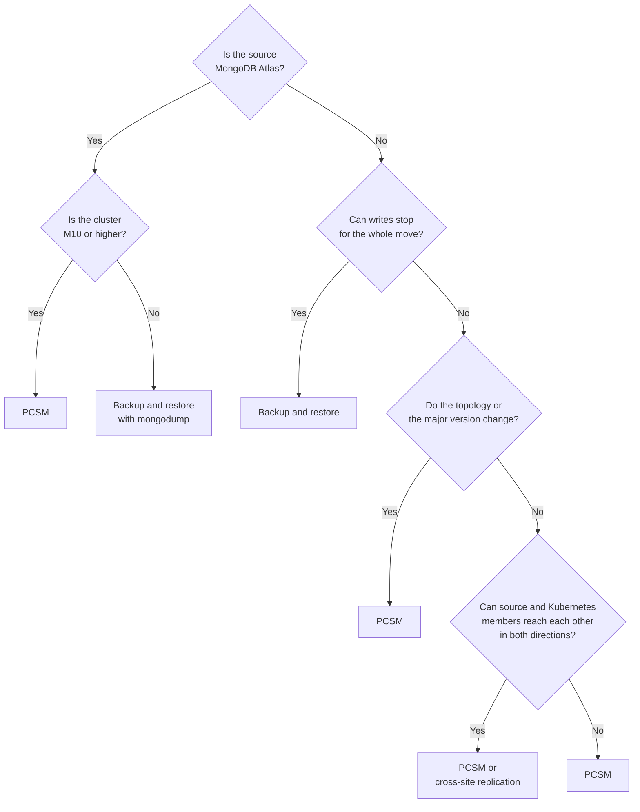

# Migrate to the Operator

Move an existing MongoDB deployment into Kubernetes and let the Operator run it from then on. You can migrate from:

* MongoDB Atlas
* A self-hosted MongoDB Community, MongoDB Enterprise Advanced or Percona Server for MongoDB deployment
* Another Kubernetes cluster that runs the Operator

## Migration methods

You can migrate using these methods:

* With [Percona ClusterSync for MongoDB (PCSM)](clustersync.md)
* With cross-site replication
* With backup and restore

PCSM and cross-site replication are online methods. The source stays available while the data copies, so applications stop only for the cutover. With backup and restore, applications stop until the restore finishes. With Percona Backup for MongoDB and point-in-time recovery, they keep writing until the cutover. With `mongodump`, writes stop from the dump.

### Choose a method

Answer the questions in the diagram to find the method for your deployment:



| Method | Downtime | Use it when | Key constraints | Procedure |
|---|---|---|---|---|
| [Percona ClusterSync for MongoDB (PCSM)](clustersync.md) | Cutover only | - The source is MongoDB Atlas M10 or higher, <br> - The topology or the major version changes, <br> - Only the target can reach the source | - Users and roles aren't copied. <br> - Some collection types aren't copied, see [PCSM limitations](clustersync.md#limitations). <br> - Backups on the target wait until the migration is finalized | [Migrate with PCSM](migration-pcsm.md) |
| Cross-site replication | Cutover only | The source is a self-hosted replica set or sharded cluster that you control. Kubernetes members join it, take over as primary and the source members leave | - The same MongoDB major version, replica set names and internal authentication keyfile on both sides. <br> - Every member reaches every other member in both directions. <br> - Not for MongoDB Atlas | [Migrate with cross-site replication](migration-replication.md) |
| Backup and restore | With PBM and point-in-time recovery, from the cutover until the restore finishes. With `mongodump`, from the dump until the restore finishes | There's no network path between the sites, a maintenance window is acceptable, or the source is MongoDB Atlas M0 or Flex | - The target runs the same major version as the source. <br> - From MongoDB Atlas, you recreate users and roles. <br> - Physical and incremental backups need a Percona Server for MongoDB source and a target without data-at-rest encryption | [Migrate with backup and restore](backups-move-from-external-db.md) |

## Before you start

Whichever method you choose, make these checks. Each guide lists the checks specific to its method.

* **Version:** on the source, find the MongoDB version and Feature Compatibility Version (FCV):

    ```javascript
    db.version()
    db.adminCommand({ getParameter: 1, featureCompatibilityVersion: 1 })
    ```

    Use them to pick the target version. Use the same major version for cross-site replication and for backup and restore. Use the same or higher version for migration with PCSM.

* **Oplog window**, for online methods: the source oplog must hold every change made while the data copies. Check the window with `rs.printReplicationInfo()` and make it longer than the expected copy time. To grow it, use [`replSetResizeOplog` :octicons-link-external-16:](https://www.mongodb.com/docs/manual/reference/command/replSetResizeOplog/) on a self-hosted source, or set a minimum oplog window in the Atlas cluster settings.
* **MongoDB Enterprise Advanced features:** list the ones you use, such as KMIP encryption at rest, LDAP, Kerberos or auditing. Configure their Percona Server for MongoDB equivalents on the target separately.
* **Ops Manager or Cloud Manager:** copy `mongod.conf` outside the data directory, unmanage the project, clear "Enforce users" and stop the automation agent. Otherwise the agent reverts your changes.
* **Target size:** give the target at least the CPU, memory and storage the source uses today.
* **Cutover plan:** decide how you stop writes, and list every application connection string to change. Until the cutover, you can abandon the migration and keep using the source. After it, there's no automatic way back.

## Next step

[Migrate with PCSM](migration-pcsm.md){.md-button}
[Migrate with cross-site replication](migration-replication.md){.md-button}
[Migrate with backup and restore](backups-move-from-external-db.md){.md-button}

New to PCSM? Read [About Percona ClusterSync for MongoDB](clustersync.md) to learn how the Operator runs PCSM and what it doesn't copy. Then [try PCSM within one Kubernetes cluster](clustersync-setup.md) on test data before you migrate production data.
