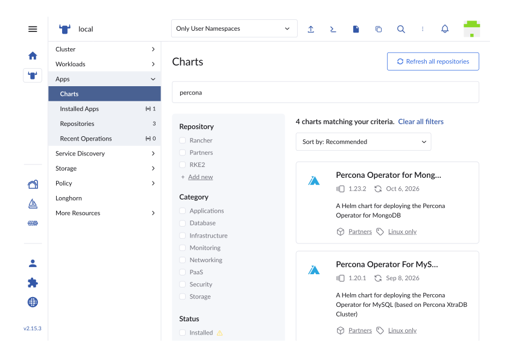
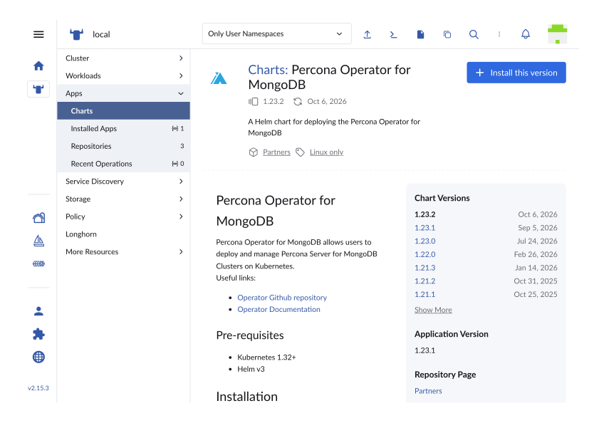
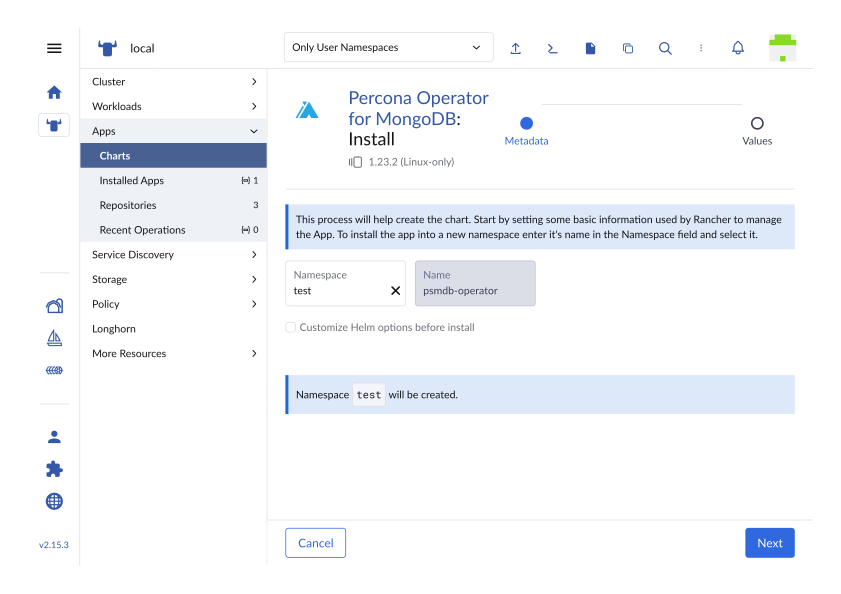
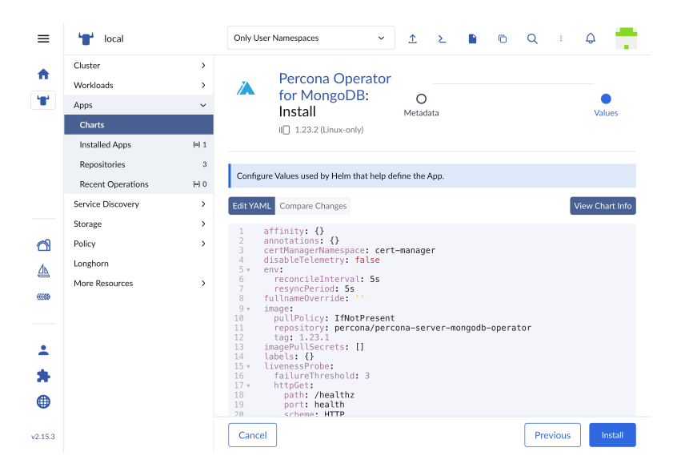
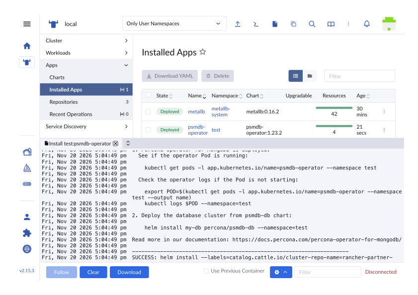
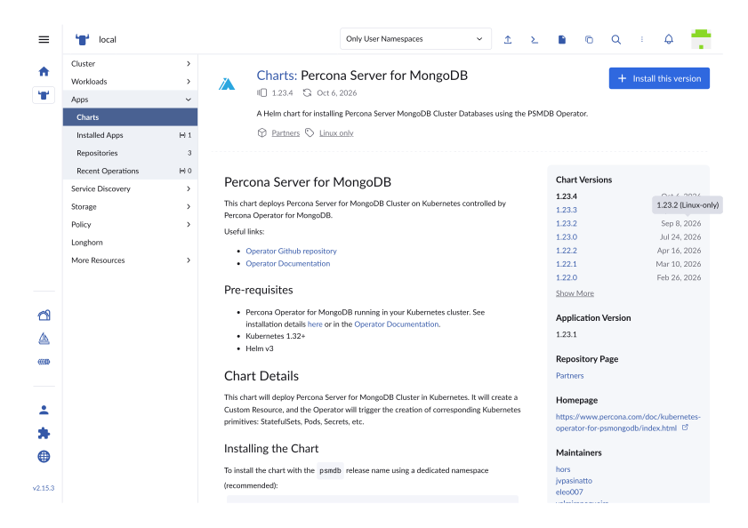
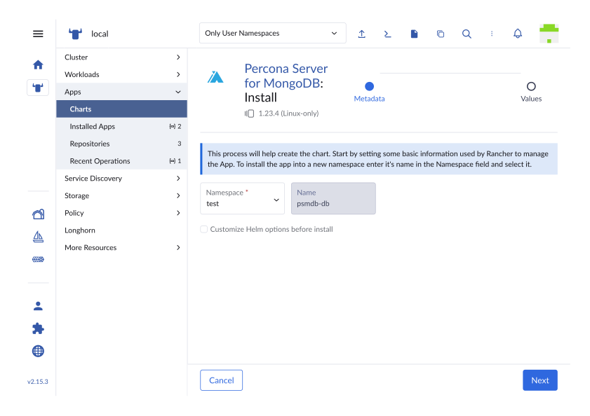
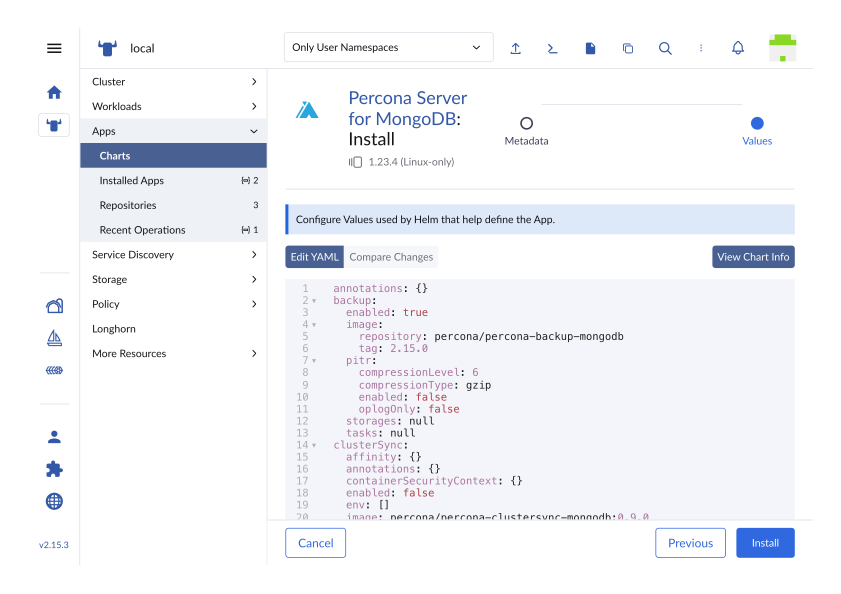
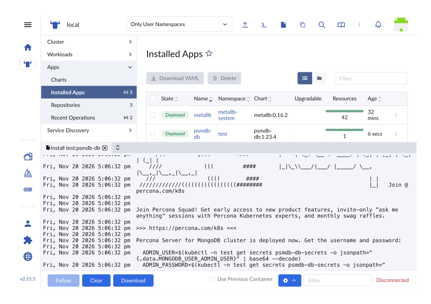

# Install Percona Server for MongoDB from Rancher Apps

If you manage your Kubernetes cluster with [Rancher Manager :octicons-link-external-16:](https://ranchermanager.docs.rancher.com/), you can install the Operator and a Percona Server for MongoDB cluster from the Rancher UI. Rancher lists the Percona Helm charts in its **Apps** catalog under the **Partners** repository, so you don't need the Helm CLI.

You install two charts in the same namespace, in this order:

| Chart in Rancher | Helm chart | What it installs |
|---|---|---|
| Percona Operator for MongoDB | `psmdb-operator` | The Custom Resource Definitions (CRDs) and the Operator Deployment |
| Percona Server for MongoDB | `psmdb-db` | A Percona Server for MongoDB cluster that the Operator manages |

This page installs the Operator in [single-namespace mode](namespace-mode.md#single-namespace-deployment).

## Before you start

* A Kubernetes cluster that Rancher Manager manages, such as an [RKE2 cluster](rke2.md). Check the Kubernetes versions in the [system requirements](System-Requirements.md).
* A Rancher user with permission to install apps in the cluster and to create namespaces.
* A default StorageClass in the cluster, such as Longhorn. Without it, the database Pods stay `Pending`. To check, open **Storage > Storage Classes** in the cluster or run `kubectl get storageclass`.
* `kubectl` access for the verification steps. You can use the **Kubectl Shell** in the Rancher top bar, the `>_` icon, instead of a local `kubectl`.

### Pick the chart version

Each chart has a chart version and an application version. The application version is the Operator version. The two versions can differ in the patch number. For example, Operator 1.23.1 is installed by the Percona Operator for MongoDB chart 1.23.2 and the Percona Server for MongoDB chart 1.23.4. See [Chart and Operator versions](helm.md#chart-and-operator-versions) for details.

On the chart page, Rancher shows the chart versions in the **Chart Versions** list and the Operator version under **Application Version**. Install the same application version from both charts. The screenshots on this page show the charts for Operator 1.23.1.

## Install the Operator

1. In the Rancher UI, select your cluster and go to **Apps > Charts**.
2. Type `percona` in the search field. To see only the Percona charts, select the **Partners** repository filter.

    

3. Select **Percona Operator for MongoDB**. In **Chart Versions**, select the version whose **Application Version** is the Operator version you want, then select **Install this version**.

    

4. On the **Metadata** step, select an existing namespace or type a new name. Rancher creates a new namespace for you.

    Select **Next**.

    

5. On the **Values** step, review the chart values in **Edit YAML**. The defaults suit most installations. For example, set `disableTelemetry: true` to turn off [telemetry](telemetry.md). See the [Operator chart parameters :octicons-link-external-16:](https://github.com/percona/percona-helm-charts/tree/main/charts/psmdb-operator#installing-the-chart) for all options.

    

6. Select **Install**. Rancher opens a tab with the Helm log. The installation is done when the log ends with `SUCCESS` and the app shows `Deployed` in **Apps > Installed Apps**.

    

The Operator chart installs the CRDs from its `crds` folder. Rancher doesn't list the CRDs as a separate app. To check them, run:

```bash
kubectl get crd | grep psmdb.percona.com
```

??? example "Expected output"

    ```{.text .no-copy}
    perconaservermongodbbackups.psmdb.percona.com
    perconaservermongodbclustersyncs.psmdb.percona.com
    perconaservermongodbrestores.psmdb.percona.com
    perconaservermongodbs.psmdb.percona.com
    ```

## Install the database cluster

1. Go to **Apps > Charts**, search for `percona` and select **Percona Server for MongoDB**.
2. In **Chart Versions**, select the version with the same **Application Version** as the Operator, then select **Install this version**.

    

3. On the **Metadata** step, select the namespace where the Operator runs. Keep the default name `psmdb-db` or type your own. Select **Next**.

    

4. On the **Values** step, review the cluster configuration in **Edit YAML**. The defaults deploy a sharded cluster with three config server Pods, three `mongos` Pods and a three-member replica set `rs0`. Change them before you install if you need to:

    * To deploy a replica set without sharding, set `sharding.enabled: false`.
    * To set the volume size or the StorageClass, edit `replsets.rs0.volumeSpec.pvc`.
    * Backups are enabled, but no backup storage is defined, so no backups run. To configure the storage, see [Configure backups](backups-configure.md).

    See the [database chart parameters :octicons-link-external-16:](https://github.com/percona/percona-helm-charts/tree/main/charts/psmdb-db#installing-the-chart) and the [Custom Resource options](operator.md) for all options.

    

5. Select **Install**. The Helm log ends with `SUCCESS` and with commands that read the credentials of the user administrator from the `<cluster-name>-secrets` Secret.

    

The Operator names the cluster after the release. If the release name contains `psmdb-db`, the cluster name is the release name, for example `psmdb-db`. Otherwise, the cluster name is `<release-name>-psmdb-db`.

## Verify

1. Check that both releases are deployed. Replace `<namespace>` with your namespace:

    ```bash
    helm list -n <namespace>
    ```

    You can also check that both apps show `Deployed` in **Apps > Installed Apps**.

2. Check the cluster status:

    ```bash
    kubectl get psmdb -n <namespace>
    ```

    The cluster is ready when `STATUS` is `ready`. This can take several minutes.

    ??? example "Expected output"

        ```{.text .no-copy}
        NAME       ENDPOINT                                         STATUS   AGE
        psmdb-db   psmdb-db-mongos.<namespace>.svc.cluster.local:27017   ready    6m
        ```

## Troubleshooting

### The Percona charts aren't in the catalog

**Symptom:** a search for `percona` in **Apps > Charts** finds nothing.

**Cause:** the **Partners** repository is missing, disabled or not refreshed.

**Fix:**

1. Go to **Apps > Repositories** and check that the **Partners** repository is listed and `Active`.
2. On the **Charts** page, select **Refresh all repositories**.

### The database Pods stay Pending

**Symptom:** after you install the `psmdb-db` app, the cluster stays in the `initializing` status and its Pods are `Pending`.

**Cause:** the PersistentVolumeClaims aren't bound because the cluster has no default StorageClass or the StorageClass in the values doesn't exist.

**Fix:**

1. Check the claims: `kubectl get pvc -n <namespace>`.
2. Set a default StorageClass, or set `storageClassName` under `volumeSpec.pvc` in the `psmdb-db` app values and upgrade the app.

For other problems, see [Troubleshooting](debug.md).

## Next steps

[Connect to Percona Server for MongoDB :material-arrow-right:](connect.md){.md-button}

## See also

* [Install with Helm](helm.md) to install the same charts with the Helm CLI
* [Install with customized parameters](custom-install.md) to change the cluster configuration at install time
* [Create a Rancher Kubernetes Engine (RKE2) cluster](rke2.md) to prepare a cluster for this installation
* [Upgrade with Rancher Apps](update-rancher.md) to upgrade the CRDs and the Operator later
* [Delete the Operator](delete.md#use-rancher-apps) to uninstall the apps and clean up what they leave behind
