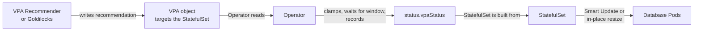

# Vertical scaling

Vertical scaling gives each database Pod more or less CPU and memory. Use it when members are resource-bound, for example when queries slow down under CPU pressure or `mongod` runs out of memory. To add members instead, see [Scale replica sets and shards](scaling.md).

You can set resources by hand, or let the Operator size them from Kubernetes [Vertical Pod Autoscaler (VPA) :octicons-link-external-16:](https://github.com/kubernetes/autoscaler/tree/master/vertical-pod-autoscaler) recommendations.

## How changes apply

Whether you change resources by hand or VPA does it, the result rolls out the same way:

* **Pods restart one at a time.** With the default [Smart Update](update.md#smart-update) strategy, the Operator recreates the Pods of the changed component one by one and restarts the primary last, so the replica set stays available.
* **The WiredTiger cache follows the memory limit.** The Operator sizes the `mongod` cache as [`cacheSizeRatio`](operator.md#replsetsstoragewiredtigerengineconfigcachesizeratio) multiplied by the memory limit minus 1 GiB, with a minimum of 0.25 GiB. If no memory limit is set, the Operator doesn't set the cache size. Changing the memory limit changes the cache. Changing only requests leaves the cache as it is.
* **New requests must fit on a node.** The scheduler adds up the requests of all containers in the Pod, sidecars included. A Pod whose requests don't fit on any node stays `Pending`, and lowering the requests afterwards doesn't fix it by itself. See [Troubleshoot Pods stuck in Pending](debug-scheduling.md) to diagnose and recover.

## Choose manual or automatic sizing

| | By hand | With VPA |
|---|---|---|
| Who picks the values | You | The VPA Recommender, within bounds you set |
| When values change | When you edit the Custom Resource | When a new recommendation passes the stabilization window |
| What you install | Nothing | The VPA Recommender and one VPA object per component |
| Fits best | Steady load, a quick fix during an incident | Load that changes over time |

## Scale by hand

1. Export your namespace. Replace `<namespace>` with your value:

    ```bash
    export NAMESPACE=<namespace>
    ```

2. Edit the component's `resources` in `deploy/cr.yaml`. This example gives the members of the replica set `rs0` 2 CPUs and 4 GB of memory:

    ```yaml
    spec:
      replsets:
      - name: rs0
        resources:
          requests:
            cpu: "2"
            memory: 4G
          limits:
            cpu: "2"
            memory: 4G
    ```

    Requests must not exceed limits. Kubernetes rejects the change otherwise.

    ??? info "Where each component's resources are set"

        | Component | Custom Resource subsection |
        |---|---|
        | Replica set members | `replsets[].resources` |
        | Non-voting members | `replsets[].nonvoting.resources` |
        | Hidden members | `replsets[].hidden.resources` |
        | Config server replica set | `sharding.configsvrReplSet.resources` |
        | `mongos` | `sharding.mongos.resources` |

        Sidecar containers such as the backup agent, PMM client and log collector have their own `resources` subsections. See [Custom Resource options](operator.md) for every field.

3. Apply the Custom Resource:

    ```bash
    kubectl apply -f deploy/cr.yaml -n $NAMESPACE
    ```

4. After the Pods restart, check the new resources and that the cluster is `ready`:

    ```bash
    kubectl get pod my-cluster-name-rs0-0 -n $NAMESPACE -o jsonpath='{.spec.containers[?(@.name=="mongod")].resources}'
    kubectl get psmdb -n $NAMESPACE
    ```

## Scale automatically with VPA

!!! note "Version added: [1.24.0](RN/Kubernetes-Operator-for-PSMONGODB-RN1.24.0.md)"

Over time, real usage moves away from the numbers you set at deploy time. Requests that are too high waste node capacity and money. Memory that is too low leads to Out of Memory (OOM) kills and cache pressure. Finding the right values by hand means watching metrics and editing the Custom Resource again and again.

Kubernetes [Vertical Pod Autoscaler (VPA) :octicons-link-external-16:](https://github.com/kubernetes/autoscaler/tree/master/vertical-pod-autoscaler) watches actual usage and calculates recommended requests for each container. With this feature, the Operator applies those recommendations to your cluster for you, within the limits you set.

What you get:

* **Right-sized Pods.** CPU and memory follow real usage instead of a guess made at deploy time.
* **Bounded, paced changes.** The Operator never applies a value outside your floor and ceiling, and waits between changes.
* **A spec that stays yours.** The Operator never writes recommendations back into the Custom Resource, so GitOps tools such as Argo CD or Flux see no drift.
* **Optional resize without restarts.** The Operator can resize running Pods in place and adjust the WiredTiger cache to match.

VPA is off by default. Upgrading the Operator doesn't change how existing clusters are sized until you enable it.

### How it works

The Operator only reads recommendations. It doesn't install VPA, create VPA objects or calculate recommendations itself. You install the VPA Custom Resource Definition and a recommender, and you create one VPA object for each component you want VPA to manage. See [Configure vertical autoscaling](scaling-vpa.md) for the steps.



1. **A recommender writes a recommendation.** The upstream VPA Recommender, [Goldilocks :octicons-link-external-16:](https://goldilocks.docs.fairwinds.com/) or any other tool writes recommended requests into the `status.recommendation` field of a VPA object. Each VPA object targets one component's StatefulSet.
2. **The Operator reads the recommendation.** On every reconcile, the Operator reads the recommendation for each managed component.
3. **The Operator decides what to apply.** It clamps the recommendation to your `minAllowed` and `maxAllowed` bounds and checks the stabilization window. It records the result in `status.vpaStatus` of the Custom Resource.
4. **The cluster converges.** The Operator generates the component's StatefulSet from the recorded values and rolls the change out.

Your `resources` in the spec stay as you declared them. They are the baseline the Operator falls back to whenever VPA isn't managing a component.

!!! warning "Don't let VPA change Pods itself"

    VPA objects have their own `spec.updatePolicy.updateMode`. Keep it at `Off` on every VPA object the Operator reads. Any other value lets the VPA Updater evict or resize Pods behind the Operator's back. For the same reason, install only the VPA Recommender, not the Updater or the Admission Controller.

### Observe and apply modes

The `spec.vpa.updateMode` option in the Custom Resource controls what the Operator does with a recommendation. Don't confuse it with the VPA object's own `updateMode`, which must always be `Off`.

| Mode | What the Operator does | Use it to |
|---|---|---|
| `Off`, the default | Records each recommendation in `status.vpaStatus`. Pods don't change. | See what VPA would do before you trust it. |
| `Auto` | Applies recommendations within your bounds and the stabilization window. | Let the cluster size itself. |

Start with `Off`, review the recommendations for a while, then switch to `Auto`. Switching from `Auto` back to `Off` returns every component to its declared `resources`, which rolls the Pods again.

### Stabilization window

The stabilization window is the minimum time between two recommendations the Operator accepts. A newer recommendation waits until the window passes. Edits you make to `resources` in the spec aren't delayed by it. When each change restarts Pods, a window of a few hours avoids frequent rolling restarts.

### Requests, limits and the WiredTiger cache

VPA recommends requests. The `spec.vpa.controlledValues` option controls what happens to limits.

| Value | Requests | Limits |
|---|---|---|
| `RequestsOnly`, the default | Set to the recommendation | Stay as declared. Requests are capped at the declared limits, so tight limits stop requests from growing. |
| `RequestsAndLimits` | Set to the recommendation | Scaled to keep your declared ratio between limit and request. |

Because the WiredTiger cache follows the memory limit, `RequestsOnly` leaves the cache as it is, while `RequestsAndLimits` resizes it together with memory.

### Restart or resize in place

By default, the Operator applies a change by recreating Pods one at a time through Smart Update.

With `spec.vpa.inPlaceResize` enabled, the Operator resizes running Pods instead and changes the WiredTiger cache size at runtime. If anything else in the Pod template changes in the same rollout, such as the image, the Operator recreates the Pod instead.

### What VPA manages and its limits

* VPA manages replica set members, non-voting and hidden members, the config server replica set and `mongos`. Each can have its own bounds and stabilization window.
* Only CPU and memory are managed. For storage, see [Resize storage](scaling-storage-resize.md).
* Arbiters and sidecar containers, such as the backup agent, PMM client and log collector, aren't managed.
* There's no maintenance window. The Operator applies a change as soon as it accepts a recommendation. To limit how often changes land, use a longer `stabilizationWindow`.
* The Operator reports VPA activity in `status.vpaStatus`, the `VPAReady` condition and its logs. It doesn't emit Kubernetes Events for VPA. With in-place resize, the kubelet records `ResizeStarted` and `ResizeCompleted` events on the Pods.
* While the cluster is [paused](pause.md), the Operator doesn't read recommendations.
* In `Auto` mode, if a VPA object that has already been applied is deleted, the Operator stops reconciling the cluster. It doesn't guess new resources. Recreate the object or switch to `Off`.

## Next steps

[Configure vertical autoscaling](scaling-vpa.md){.md-button}

## See also

* [Troubleshoot vertical autoscaling](debug-vpa.md) for VPA-specific failures
* [Troubleshoot the Operator](troubleshoot-operator.md) for other problems
* [Scale replica sets and shards](scaling.md) to add members instead of resources
* [Resize storage](scaling-storage-resize.md) to grow volumes, which vertical scaling doesn't change
* [Custom Resource options](operator.md#operator-vpa-section) for every `vpa` option and its default
