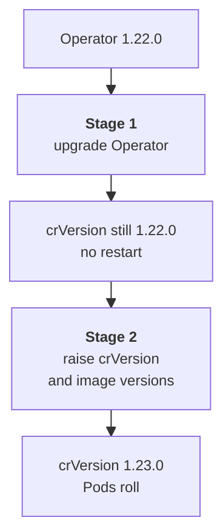

# Update Percona Operator for MongoDB

Use this page to understand how upgrades work, check compatibility before you start, and pick the right procedure.

An upgrade has two independent stages:

* Upgrade the Operator and Custom Resource Definition (CRD)
* Upgrade the database (Percona Server for MongoDB)

You can run both stages, or only the database stage, depending on what you need to change. See [Choose your upgrade path](#choose-your-upgrade-path) for use cases. See [How an upgrade works](#how-an-upgrade-works) to understand the upgrade workflow. See [crVersion behavior](update-crversion.md) to understand how the Custom Resource version affects the cluster behavior.

!!! note "Something already went wrong?"

    If Pods are stuck in `Init:ErrImagePull`, a cluster is stuck in `initializing`, or Pods restarted after you re-applied a manifest, see [Troubleshoot upgrades and `crVersion` problems](debug-upgrade.md).

## Choose your upgrade path

### Upgrade the Operator and CRD

Upgrade the Operator and CRD when new database features need changes in this Operator version, when you want automation or fixes from the new Operator, or when compatibility between the Operator and the database requires a synchronized update.

| You installed the Operator via | Use |
| --- | --- |
| `kubectl` | [Upgrade manually](update-crd-manual.md) |
| Helm | [Upgrade via Helm](update-crd-helm.md) |
| OLM on OpenShift | [Upgrade via OLM](update-crd-olm.md) |

### Upgrade the database

Upgrade the database after you have already upgraded the Operator and now want to move the database forward, or when the new database version has features or fixes unrelated to the Operator. Check the [version compatibility matrix](versions.md) first to confirm that your current Operator version supports the new database version.

| You want to | Use |
| --- | --- |
| Let the Operator upgrade the database automatically | [Automatic minor upgrades](update-minor-automatic.md) |
| Pin the database to a specific version | [Upgrade to a specific version](update-minor-set-version.md) |
| Control each Pod restart yourself (Rolling Update or On Delete) | [Upgrade manually](update-manually.md) |
| Move to the next major MongoDB version | [Major upgrades](update-major.md) |

On OpenShift, database upgrades follow a different procedure. See [Upgrade Percona Server for MongoDB on OpenShift](update-openshift.md).

## Before you upgrade

Do these for every upgrade:

* **Take a backup first.** See [Backup and restore](backups.md) or [On-demand backup](backup-tutorial.md).
* **Test in staging first.** This matters most for Operator upgrades and major database version upgrades. Operator upgrades can cause performance degradation.
* **Move one version at a time.** You can upgrade the Operator only to the nearest `major.minor` version, and database major versions also move one at a time. Bigger gaps need several sequential upgrades. See [Considerations](update-operator.md#for-the-operator-upgrades) and [Major version upgrades](update-major.md).

Check whether any of these apply to you:

| If | Then |
| --- | --- |
| Your Operator is more than two minor versions ahead of a cluster's [`crVersion`](update-crversion.md) | The combination is outside the supported window. Plan stage 2 first. See [Why the stages can be separated](#why-the-stages-can-be-separated). |
| You set [`upgradeOptions.setFCV`](operator.md#upgradeoptionssetfcv) | Downgrading the image afterward does not undo it. See [Feature Compatibility Version](update-major.md#feature-compatibility-version). |
| You run MongoDB 4.4 or 5.0 | MongoDB 4.4 reached end of life in Operator 1.16.0, and 5.0 in Operator 1.19.0. Upgrade the database to a supported major version before you upgrade the Operator past those releases. See [End of Life versions of MongoDB](update-minor-automatic.md#procedure). |
| You run Operator 1.19.0 or 1.19.1 with a sharded cluster and MongoDB 8.0 | Point-in-time recovery can fail. See [Considerations](update-operator.md#considerations). |
| You re-apply a manifest that omits `crVersion`, or you deploy with Argo CD | A re-applied manifest can roll the Pods unexpectedly, and Argo CD can report drift. See [Why to set `crVersion` explicitly](update-crversion.md#why-to-set-crversion-explicitly). |

To apply a security build for the Operator version you already run, see [Operator security builds](security-builds.md).

## How an upgrade works

You decide when to run each stage. Stage 2 does not have to follow stage 1 immediately.

<div markdown="1" style="text-align: center">



</div>

**Stage 1: upgrade the Operator.** You install the new version of the CRD and the Operator Deployment. The Operator runs in its own Pod and is not in the data path, so updating it does not interrupt client connections. Your database Pods are not restarted, because the cluster Custom Resource still declares the old `crVersion` and the old images. The new Operator recognizes that version and keeps managing the cluster with the behavior it already had.

**Stage 2: upgrade the database.** Raise [`crVersion`](update-crversion.md) and the image versions in the Custom Resource. You can do this during a maintenance window, in a quieter period, or for one cluster at a time. The change rolls the database Pods. With the default [Smart Update](#update-strategies) strategy, the Operator restarts Pods one at a time and updates the primary last, which reduces connection disruption. Clients can still see a short interruption when the primary restarts.

If you deploy with Argo CD and set `crVersion` explicitly, you run stage 2 by changing `crVersion` and the image versions in Git. See [Keep Argo CD in sync with `crVersion`](update-crversion.md#keep-argo-cd-in-sync-with-crversion).

!!! note

    The procedures on the individual upgrade pages patch `crVersion` and the images in one command, which runs both stages back to back. To keep the stages apart, upgrade the CRD and Operator first, then patch `crVersion` and the images later.

### Why the stages can be separated

The CRD supports clusters whose `crVersion` is within the last three minor Operator versions: the current one and the two before it. For example, with Operator 1.23.0 installed, clusters that still declare `crVersion: 1.22.0` or `crVersion: 1.21.0` are supported and keep running normally. A cluster does not have to move the moment you upgrade the Operator.

That window is also the limit. Once your Operator is more than two minor versions ahead of a cluster's `crVersion`, the cluster has to catch up. Plan stage 2 before your Operator gets more than two minor versions ahead of a cluster's `crVersion`. See [Considerations](update-operator.md#considerations).

For what `crVersion` does and how the Operator handles different values, see [`crVersion` behavior](update-crversion.md).

### Apply a security build

Apply a security build to patch the Operator version you already run with the fixes for High and Critical Common Vulnerabilities and Exposures (CVE). See [Apply security builds](security-builds.md).

## Update strategies

Set `updateStrategy` in the [Custom Resource](operator.md) to choose how the Operator or Kubernetes updates your cluster:

<a name="smart-update"></a><a name="rolling-update"></a><a name="on-delete"></a>

| Strategy | Who controls the restarts | Notes |
| --- | --- | --- |
| `SmartUpdate` (default, recommended) | The Operator | Restarts Pods so the primary is updated last, which reduces connection disruption. Also applies when you change a ConfigMap, rotate passwords, or change resource values, not only during database version upgrades. |
| `RollingUpdate` | [Kubernetes :octicons-link-external-16:](https://kubernetes.io/docs/concepts/workloads/controllers/statefulset/#update-strategies) | The StatefulSet controller deletes a Pod, updates it, waits until it reports Ready, then moves to the next Pod. The order matches Pod termination order, which may not be optimal for Percona Server for MongoDB. |
| `OnDelete` | You | You delete each Pod, and the StatefulSet controller recreates it with the updated configuration. |

For upgrades that use `RollingUpdate` or `OnDelete`, see [Upgrade manually](update-manually.md).

<a name="revision-history-limit"></a>Each time the Operator updates a StatefulSet Pod template, Kubernetes stores a revision in the StatefulSet history. Set [`spec.revisionHistoryLimit`](operator.md#revisionhistorylimit) to control how many revisions are kept: lower to reduce stale revisions in the namespace, higher to keep more rollback points. When you omit it, Kubernetes keeps 10.

```yaml
spec:
  updateStrategy: SmartUpdate
  revisionHistoryLimit: 10
```

## See also

* [Upgrade the Operator and CRD](update-operator.md)
* [Apply security builds](security-builds.md)
* [Upgrade Percona Server for MongoDB](update-db.md)
* [`crVersion` behavior](update-crversion.md)
* [Known limitations](limitations.md)
* [`crVersion` option reference](operator.md#crversion)
* [Use Docker images from a custom registry](custom-registry.md)
* [Custom resource statuses](cr-statuses.md#perconaservermongodb-status)
